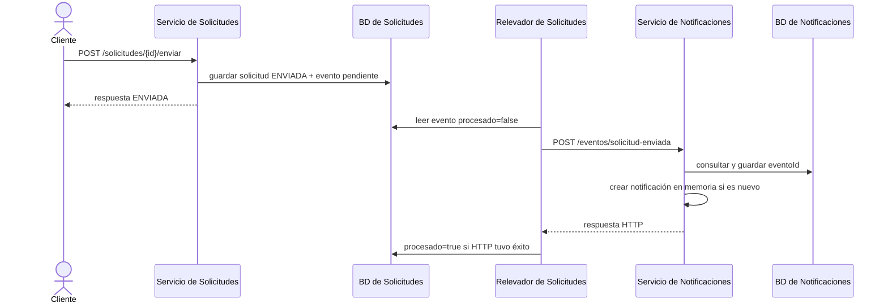

# Componentes Java y ejecución

ARKA-Lite tiene dos proyectos Maven independientes: `servicio-solicitudes/` y `servicio-notificaciones/`. Cada uno tiene su propia clase `*Application`, `pom.xml`, pruebas, Maven Wrapper y `Dockerfile`. El `pom.xml` de la raíz corresponde al monolito anterior; para compilar el sistema vigente se entra en cada carpeta.

## Capas y conceptos

```text
HTTP del cliente
  → adaptador de entrada (Controller)
  → dominio (reglas y puertos)
  → adaptador de persistencia (JPA/PostgreSQL)
  → adaptador de salida (publicación HTTP, cuando corresponde)
```

Un **puerto** es una interfaz que el dominio necesita; un **adaptador** aporta la implementación concreta. Spring conecta los componentes mediante constructores, `@Component`, `@Repository`, `@Primary`, `@Configuration` y `@Bean`. `@Transactional` agrupa operaciones de BD en una transacción. `@Scheduled` permite ejecutar el relevador de eventos pendientes.

| Paquete | Contenido |
|---|---|
| `dominio/` | Reglas de `Solicitud` y `Notificacion`, servicios y puertos. |
| `adaptadores/entrada/` | Controladores HTTP, errores y consumo idempotente. |
| `adaptadores/persistencia/` | Entidades y repositorios JPA usados con PostgreSQL. |
| `adaptadores/salida/` | Publicador HTTP, relevador, repositorios en memoria donde todavía aplican. |
| `config/` | Creación y conexión de beans de dominio. |
| `eventos/` | Contrato `SolicitudEnviada` intercambiado por HTTP. |

## Servicio de Solicitudes

| Componente | Responsabilidad actual |
|---|---|
| `ServicioSolicitudesApplication` | Arranca Spring y habilita la ejecución programada con `@EnableScheduling`. |
| `SolicitudController` | Expone `/solicitudes` y delega en el dominio. |
| `Solicitud` y `Estado` | Reglas y transiciones `BORRADOR → ENVIADA → APROBADA/RECHAZADA`. |
| `ServicioDeSolicitudes` | Registra, busca y cambia solicitudes; `enviar()` guarda el estado y un evento saliente en la misma transacción. |
| `RepositorioDeSolicitudes` / `RepositorioJpa` | Puerto e implementación activa de persistencia de solicitudes. |
| `RegistradorDeEventosSalientes` / `RegistradorDeEventosJpa` | Puerto y adaptador que guardan el evento pendiente en la tabla `evento`. |
| `EventoEntity` / `EventoJpaRepository` | Representación JPA del outbox y consulta de filas `procesado=false`. |
| `RelevadorDeEventosPendientes` | Consulta pendientes con `fixedDelay=5000`, publica y marca los eventos entregados. |
| `PublicadorDeEventos` / `PublicadorConReintento` | Puerto e implementación activa (`@Primary`) que hace hasta tres POST HTTP. |
| `PublicadorRest` | Publicador anterior sin reintentos; queda en el código, pero no es el bean seleccionado por defecto. |

`OperacionEnviar` también sigue en el código, pero no está conectada al flujo de `ServicioDeSolicitudes.enviar()`. La configuración activa usa `RepositorioJpa` y `RegistradorDeEventosJpa`. El `CommandLineRunner` de `ConfiguracionDominio` guarda `INC-001` y `CAM-002` y envía `CAM-002` **en cada arranque**. Con una BD persistente, esto puede restablecer los estados de esas solicitudes y crear un evento adicional.

La BD propia de este servicio se llama `db-solicitudes`. `schema.sql` define `solicitud` y `evento`; `application.properties` configura `DB_URL`, `DB_USER`, `DB_PASSWORD` y la URL HTTP de Notificaciones.

## Servicio de Notificaciones

| Componente | Responsabilidad actual |
|---|---|
| `ServicioNotificacionesApplication` | Arranca Spring Boot. |
| `EventoController` | Recibe `POST /eventos/solicitud-enviada` y expone `GET /eventos/procesados`. |
| `ConsumoIdempotente` | Consulta si `eventoId` ya existe; si es nuevo, crea la notificación y guarda el ID procesado. |
| `EventoProcesadoEntity` / `EventoProcesadoRepository` | Persisten los ID recibidos en la tabla `evento_procesado`. |
| `ServicioDeNotificaciones` | Construye el texto de la notificación. |
| `RepositorioEnMemoria` | Guarda las **notificaciones** como objetos en una lista; no usa PostgreSQL para esos objetos. |
| `NotificacionController` | Expone `GET /notificaciones` con los objetos actualmente en memoria. |

La BD propia de Notificaciones se llama `db-notificaciones`. Hibernate configura `evento_procesado` mediante `ddl-auto=update`; `schema.notificaciones.sql` también declara la tabla, pero no se fuerza su ejecución con `spring.sql.init.mode=always`. La transacción de `ConsumoIdempotente` cubre la escritura JPA del ID; no convierte la lista en memoria en almacenamiento duradero.

## Recorrido entre servicios



Si el POST falla, `PublicadorConReintento` hace hasta tres intentos. Si se agotan, el relevador deja `procesado=false` para el próximo ciclo. La comunicación sigue siendo HTTP; el outbox conserva eventos salientes entre intentos y reinicios. La [comparativa desde `main`](especificacion-eventos-outbox.md) explica qué parte se incorporó en cada commit.

## Contrato de evento

`SolicitudEnviada` contiene `eventoId`, `id` y `tipo`. El `eventoId` generado en Solicitudes se guarda en el outbox y se reutiliza en los reintentos. En el flujo actual, `tipo` se envía como el literal `SolicitudEnviada`; antes se enviaba el tipo de negocio, por ejemplo `Incidencia`.

## Ejecutar y estudiar

Para arrancar ambos servicios con sus PostgreSQL:

```powershell
docker compose up --build -d
docker compose ps
```

Para ejecutar pruebas por servicio:

```powershell
Push-Location servicio-solicitudes
.\mvnw.cmd clean verify
Pop-Location

Push-Location servicio-notificaciones
.\mvnw.cmd clean verify
Pop-Location
```

Orden recomendado para leer el código: `SolicitudController` → `ServicioDeSolicitudes` → `RepositorioJpa` y `RegistradorDeEventosJpa` → `RelevadorDeEventosPendientes` → `PublicadorConReintento` → `EventoController` → `ConsumoIdempotente`.

Para puertos, variables y comandos de Kubernetes, consultar [Kubernetes local](../operaciones/kubernetes-local.md) y [PostgreSQL en Kubernetes](../operaciones/postgresql-kubernetes.md).
