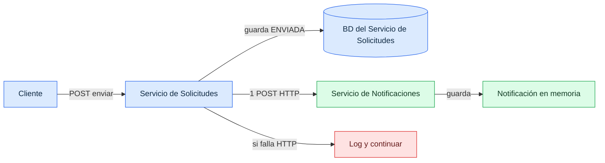
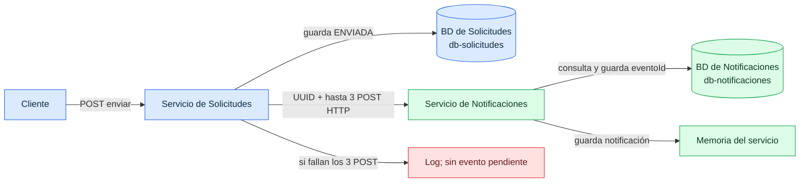
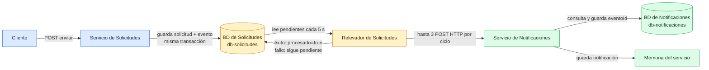
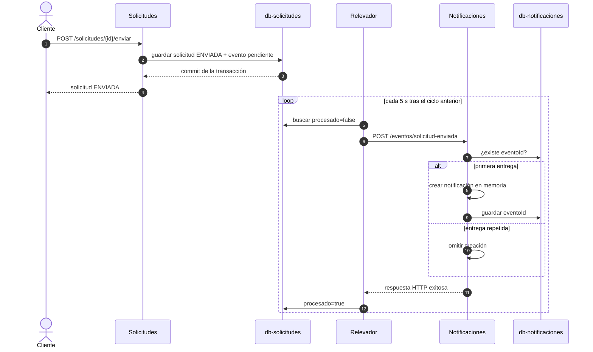
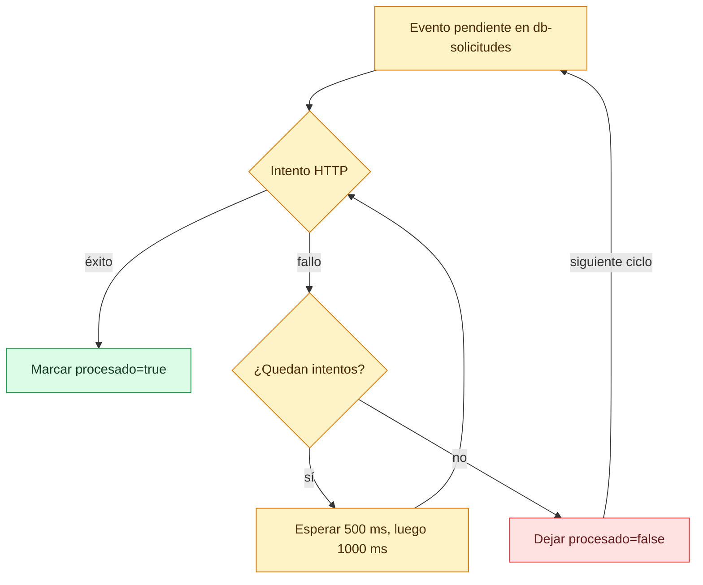

# Evolución del flujo de eventos: `main` → tus cambios → ajuste de Felipe

**Proyecto:** ARKA-Lite  
**Base revisada:** `main` (`513fa74`) → rama `feat/add-edd-to-app-and-retry-policy` (`1dde0e4`)  
**Fecha:** 14 de octubre de 2026  
**Alcance:** comportamiento implementado en el código, sin asumir despliegue ni pruebas de integración exitosas.

## 1. Lectura rápida de los tres estados

**`main` (`513fa74`):** El **cliente** llamaba al **Servicio de Solicitudes**. Este guardaba la solicitud en **su propia base de datos**, luego llamaba por HTTP al **Servicio de Notificaciones**. Notificaciones guardaba la notificación **en memoria**: en esta etapa no tenía una base de datos propia. Si el POST fallaba, `PublicadorRest` registraba el error y continuaba. La tabla `evento` existía en la base de Solicitudes, pero este camino de `enviar()` no la escribía.

**Tus commits (`57250e7`, `924cf3b`, `ac868cf`):** El cliente seguía llamando a Solicitudes, que guardaba la solicitud en **db-solicitudes** y llamaba por HTTP a Notificaciones hasta tres veces. Agregaste **db-notificaciones** para guardar los **ID de eventos procesados** y evitar duplicados; las notificaciones mismas seguían en memoria. El POST seguía dentro de `enviar()`. Si fallaban los tres intentos, el evento solo quedaba en el log; la cola de pendientes estaba comentada.

**Felipe (`1dde0e4`):** El cliente sigue llamando a Solicitudes, pero ahora Solicitudes guarda **la solicitud y un evento pendiente en db-solicitudes** dentro de una transacción. Un relevador del mismo Servicio de Solicitudes lee esa base y llama después por HTTP al Servicio de Notificaciones. Notificaciones consulta y escribe los ID en **su db-notificaciones** y crea la notificación en memoria. Felipe conservó tu publicador con tres intentos y tu deduplicación.

> **Resultado:** tu trabajo resolvió la identificación de eventos, la separación de bases y los fallos transitorios de HTTP. Felipe resolvió que un evento siguiera disponible después de agotar los intentos o reiniciar Solicitudes.

## 2. Comparación lado a lado

| Pregunta | `main` | Tus cambios, antes de Felipe (`ac868cf`) | Con Felipe (`1dde0e4`) |
|---|---|---|---|
| ¿Qué hace `enviar()`? | Guarda la solicitud `ENVIADA` y llama a `PublicadorRest` en la misma petición. | Guarda `ENVIADA` y llama a `PublicadorConReintento` en la misma petición. | Guarda `ENVIADA` y una fila pendiente de `evento` en una transacción; el HTTP queda para el relevador. |
| ¿Cuántos intentos HTTP? | Uno. | Hasta tres por llamada (esperas de 500 y 1000 ms). | Hasta tres por ciclo del relevador; nuevos ciclos mientras la fila siga pendiente. |
| ¿Qué pasa al agotar intentos? | `PublicadorRest` captura la excepción, escribe en `stderr` y retorna. | Se escribe en `stderr` y el método retorna; la cola en memoria está comentada. | Se lanza `PublicacionFallidaException`; `procesado=false` permanece en la base para otro ciclo. |
| ¿El evento tiene ID estable? | El mensaje solo tiene `id` y `tipo`; no hay `eventoId`. | Se genera un UUID por envío y se reutiliza en los tres intentos de esa llamada. No se persiste para reintentos posteriores. | El UUID se guarda en `evento.evento_id` y se reutiliza en cada ciclo. |
| ¿Qué almacena Solicitudes? | La solicitud; existe tabla `evento`, pero `enviar()` no la usa. | La solicitud; `enviar()` aún no registra el evento. | Solicitud y evento pendiente en `db-solicitudes`. |
| ¿Qué almacena Notificaciones? | Notificaciones en memoria; no hay registro de ID procesados. | Notificaciones en memoria e ID procesados en `db-notificaciones.evento_procesado`. | Igual que tu etapa; Felipe no modificó el código de Notificaciones. |
| ¿Qué bases de datos existen? | **Solo la base del Servicio de Solicitudes** (`base-datos`, con la BD `arka` en Compose). Notificaciones no tiene base propia. | Dos bases separadas: `db-solicitudes` para Solicitudes y `db-notificaciones` para los ID procesados de Notificaciones. | Las mismas dos bases; Felipe agrega el uso real del outbox en `db-solicitudes.evento`. |
| ¿Se evitan duplicados? | No hay deduplicación por evento. | Sí, por `eventoId` ya registrado, con los límites de concurrencia indicados abajo. | Se usa tu deduplicación porque el outbox puede repetir entregas. |
| ¿Qué espera el cliente? | El intento HTTP inmediato, aunque el fallo se absorbe. | Hasta tres intentos HTTP antes de terminar `enviar()`. | Solo el guardado de la solicitud y el evento; la entrega ocurre después. |
| Campo `tipo` del mensaje | Tipo de negocio de la solicitud, por ejemplo `Incidencia`. | Sigue siendo el tipo de negocio. | Se publica el literal `SolicitudEnviada`; cambia el texto que construye Notificaciones. |

### Mismo escenario: Notificaciones no responde

| Etapa | Resultado observable |
|---|---|
| `main` | La solicitud queda enviada. El único POST falla, se registra el error y no queda un evento pendiente para recuperarlo. |
| Tus cambios | La solicitud queda enviada. Se hacen hasta tres POST con el mismo `eventoId`; si todos fallan, no queda un pendiente persistente. |
| Felipe | La solicitud y el evento quedan en PostgreSQL. El relevador hace hasta tres POST por ciclo; si fallan, la fila sigue pendiente y se intentará en otro ciclo. |

## 3. Diagramas comparativos

### 3.1 `main`: una sola base, propiedad de Solicitudes



**En `main` no había una BD del Servicio de Notificaciones.** Su repositorio guardaba objetos en memoria. La BD `arka` del contenedor `base-datos` era usada por Solicitudes.

**Orden real:** (1) el cliente invoca `POST /solicitudes/{id}/enviar`; (2) Solicitudes guarda `ENVIADA` en su BD; (3) el propio servicio llama a Notificaciones por HTTP **antes de responder al cliente**; (4) Notificaciones crea una notificación en memoria. Si el paso 3 falla, `PublicadorRest` escribe el error en el log y la petición de envío continúa. No hay una fila pendiente que active otro intento.

### 3.2 Tus cambios: cada servicio ya tiene su base, pero solo los ID se guardan en la de Notificaciones



**La BD de Notificaciones no guarda las notificaciones:** solo los `eventoId` recibidos. Las notificaciones siguen en memoria.

**Orden real:** (1) el cliente llama a Solicitudes; (2) Solicitudes guarda `ENVIADA` en `db-solicitudes` y crea un UUID; (3) en la misma petición intenta el POST a Notificaciones hasta tres veces; (4) Notificaciones consulta `db-notificaciones.evento_procesado`, crea la notificación en memoria si el ID es nuevo y registra ese ID en su BD. Si los tres POST fallan, el publicador solo deja un mensaje en el log: no registra un evento saliente para un intento futuro.

### 3.3 Con Felipe: Solicitudes escribe su outbox y después llama a Notificaciones



**Leyenda:** azul = entrada y Servicio de Solicitudes; ámbar = BD de Solicitudes usada como outbox y su relevador; verde = Servicio de Notificaciones, su BD de ID procesados y su memoria; rojo = evento sin recuperación automática. **Las bases son de servicios distintos; no hay una BD compartida por ambos.**

**Orden real:** (1) el cliente llama a Solicitudes; (2) Solicitudes confirma en **una transacción** el cambio a `ENVIADA` y una fila `evento` con `procesado=false` en `db-solicitudes`; (3) responde al cliente; (4) el relevador de Solicitudes consulta después los pendientes; (5) publica por HTTP con hasta tres intentos; (6) Notificaciones deduplica con **su** `db-notificaciones` y crea la notificación en memoria si corresponde; (7) el relevador marca `procesado=true` solo tras una respuesta HTTP exitosa. Si el POST falla, la fila sigue pendiente para otro ciclo.

## 4. Commit por commit: qué cambió cada persona

| Commit | Autor | Aporte |
|---|---|---|
| `57250e7` | JFranceschi-Dev | Separó `db-solicitudes` y `db-notificaciones` en Compose, Kubernetes y CI. Agregó PostgreSQL e idempotencia en Notificaciones, `eventoId` al mensaje y el primer publicador con hasta tres intentos. |
| `924cf3b` | JFranceschi-Dev | Eliminó cuatro archivos de laboratorio y resultados. No alteró el flujo de eventos. |
| `ac868cf` | JFranceschi-Dev | Conectó `PublicadorConReintento` como implementación activa y expuso `GET /eventos/procesados` para consultar los ID guardados. |
| `1dde0e4` | Felipe Icaza | Añadió el outbox duradero en Solicitudes: evento y solicitud en una transacción, relevador periódico, marca de publicado y adaptación de pruebas. |

## 5. Vista de arquitectura actual

```mermaid
flowchart LR
    U[Cliente] -->|POST /solicitudes/{id}/enviar| S[Servicio de Solicitudes]
    S -->|misma transacción| DS[(db-solicitudes<br/>solicitud + evento)]
    DS -->|lee procesado=false<br/>cada 5 s| R[Relevador]
    R -->|POST HTTP<br/>hasta 3 intentos| N[Servicio de Notificaciones]
    N -->|consulta y registra eventoId| DN[(db-notificaciones<br/>evento_procesado)]
    N -->|crea| M[Notificación en memoria]
    R -->|si HTTP termina bien| DS
    classDef solicitud fill:#dbeafe,stroke:#2563eb,color:#102a43,stroke-width:2px;
    classDef outbox fill:#fef3c7,stroke:#d97706,color:#4a2b00,stroke-width:2px;
    classDef notificacion fill:#dcfce7,stroke:#16a34a,color:#123b24,stroke-width:2px;
    classDef memoria fill:#fee2e2,stroke:#dc2626,color:#641b1b,stroke-width:2px;
    class U,S solicitud;
    class DS,R outbox;
    class N,DN notificacion;
    class M memoria;
```

**Leyenda:** azul = entrada y dominio de Solicitudes; ámbar = outbox y publicación; verde = recepción y deduplicación; rojo = almacenamiento volátil de la notificación.

## 6. Secuencia de una entrega correcta en el estado actual



El intervalo es `fixedDelay = 5000`: el siguiente ciclo empieza aproximadamente cinco segundos después de terminar el anterior. No es una garantía de entrega en exactamente cinco segundos.

## 7. Contratos y datos

### 7.1 Evento HTTP

`SolicitudEnviada` tiene tres campos en ambos servicios:

```json
{
  "eventoId": "87e3e5f5-4d27-4aa2-a521-9499fa498078",
  "id": "INC-002",
  "tipo": "SolicitudEnviada"
}
```

`eventoId` es un UUID generado una vez en `ServicioDeSolicitudes.enviar()` y conservado en el outbox para todos los reintentos. `id` es el identificador de la solicitud. **En el flujo actual, `tipo` se guarda como el literal `SolicitudEnviada`, no como el tipo de negocio de la solicitud** (por ejemplo, `Incidencia`). Esta diferencia afecta el texto que crea Notificaciones.

### 7.2 Tablas

| Base y tabla | Campos principales | Uso |
|---|---|---|
| `db-solicitudes.solicitud` | `id`, `tipo`, `estado` | Estado de negocio de la solicitud. |
| `db-solicitudes.evento` | `id`, `solicitud_id`, `tipo`, `evento_id`, `procesado` | Outbox. `procesado=false` permanece pendiente; `true` significa que el POST terminó sin excepción. |
| `db-notificaciones.evento_procesado` | `evento_id` (PK) | Registro de ID ya recibidos; permite ignorar repeticiones. |

La tabla `evento` tiene un índice parcial para filas con `procesado=false`. La entidad Java de Solicitudes usa `UUID` para `evento_id`; Notificaciones recibe el ID como `String` de hasta 64 caracteres.

### 7.3 API relevante

| Método y ruta | Servicio | Comportamiento |
|---|---|---|
| `POST /solicitudes/{id}/enviar` | Solicitudes | Cambia el estado a `ENVIADA` y registra el evento pendiente. La respuesta no espera la entrega HTTP. |
| `POST /eventos/solicitud-enviada` | Notificaciones | Procesa un ID nuevo; ignora uno ya registrado. |
| `GET /eventos/procesados` | Notificaciones | Devuelve la lista de ID existentes en `evento_procesado`. |

## 8. Fallos y reintentos



- El publicador hace **hasta tres intentos por ciclo**, con esperas de 500 ms y 1000 ms antes del segundo y tercer intento.
- Si se agotan, lanza `PublicacionFallidaException`; el relevador deja la fila pendiente y la vuelve a leer en otro ciclo.
- Si el POST fue aceptado pero falla el guardado de `procesado=true`, puede repetirse la entrega. El receptor compara `eventoId` para evitar crear otra notificación durante la misma ejecución.
- Si falla la transacción inicial, no debería quedar solo la solicitud enviada o solo el evento: ambos registros participan en `ServicioDeSolicitudes.enviar()` anotado con `@Transactional`.

## 9. Alcance real y límites observables

1. **La notificación no es duradera.** `ServicioDeNotificaciones` usa `RepositorioEnMemoria`; la base de Notificaciones solo guarda `evento_procesado`. Tras reiniciar Notificaciones, puede conservarse el ID deduplicado mientras la notificación desaparece. Por ello, el registro de ID y la creación de la notificación no constituyen una unidad duradera, aunque `ConsumoIdempotente.alRecibir()` tenga `@Transactional`.
2. **El marcado del outbox es posterior al HTTP.** El diseño admite entrega repetida y depende de la deduplicación del receptor. Es una entrega de tipo *al menos una vez*, condicionada a que el relevador siga ejecutándose y las bases estén disponibles.
3. **No hay coordinación visible entre varias réplicas del relevador.** `findByProcesadoFalse()` no reclama ni bloquea filas; dos instancias podrían publicar el mismo evento. La deduplicación mitiga el duplicado, pero el repositorio en memoria y la comprobación `existsById` seguida de `save` no aseguran un resultado atómico entre réplicas.
4. **Los errores del relevador se silencian.** El `catch (RuntimeException)` no registra la causa. El evento queda pendiente, pero la observabilidad del fallo es limitada.
5. **La migración de una base existente requiere revisión.** `schema.sql` usa `CREATE TABLE IF NOT EXISTS`; no añade por sí solo `evento_id` y `procesado` a una tabla `evento` ya creada con el esquema anterior. Esto es relevante al desplegar sobre datos previos.

Estos puntos describen límites del código actual; no son cambios incluidos en esta especificación.

## 10. Archivos que implementan el flujo

- Solicitudes: `servicio-solicitudes/.../dominio/ServicioDeSolicitudes.java`, `.../adaptadores/persistencia/RegistradorDeEventosJpa.java`, `.../adaptadores/salida/RelevadorDeEventosPendientes.java`, `.../adaptadores/salida/PublicadorConReintento.java`, `src/main/resources/schema.sql`.
- Notificaciones: `servicio-notificaciones/.../adaptadores/entrada/ConsumoIdempotente.java`, `.../adaptadores/entrada/EventoController.java`, `.../adaptadores/salida/RepositorioEnMemoria.java`, `src/main/resources/schema.notificaciones.sql`.
- Entornos: `compose.yaml`, `k8s/db-solicitudes.yaml`, `k8s/db-notificaciones.yaml`, `.github/workflows/ci.yml`.

---

**Criterio de lectura:** esta especificación se basa en los cuatro commits posteriores a `main` y en el árbol de archivos en `1dde0e4`. No certifica la ejecución del sistema ni equivale a una prueba de integración.
