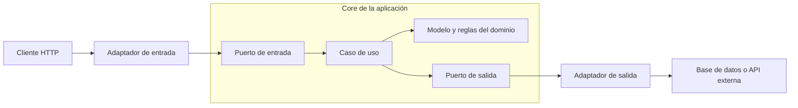
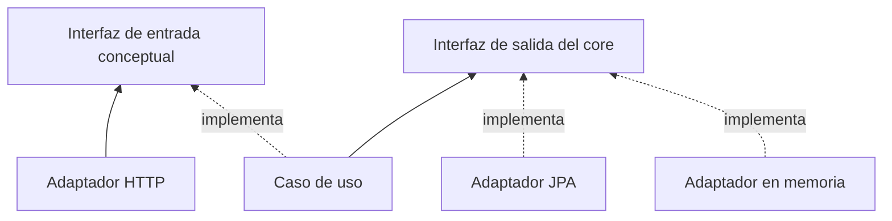
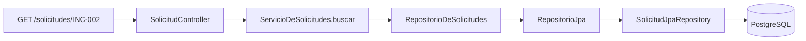
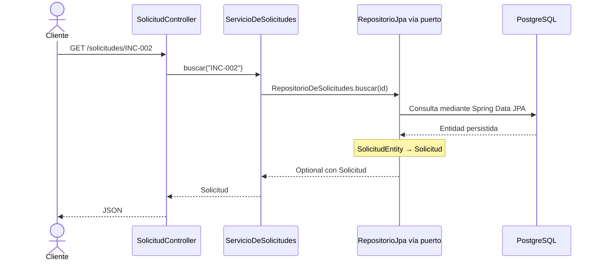
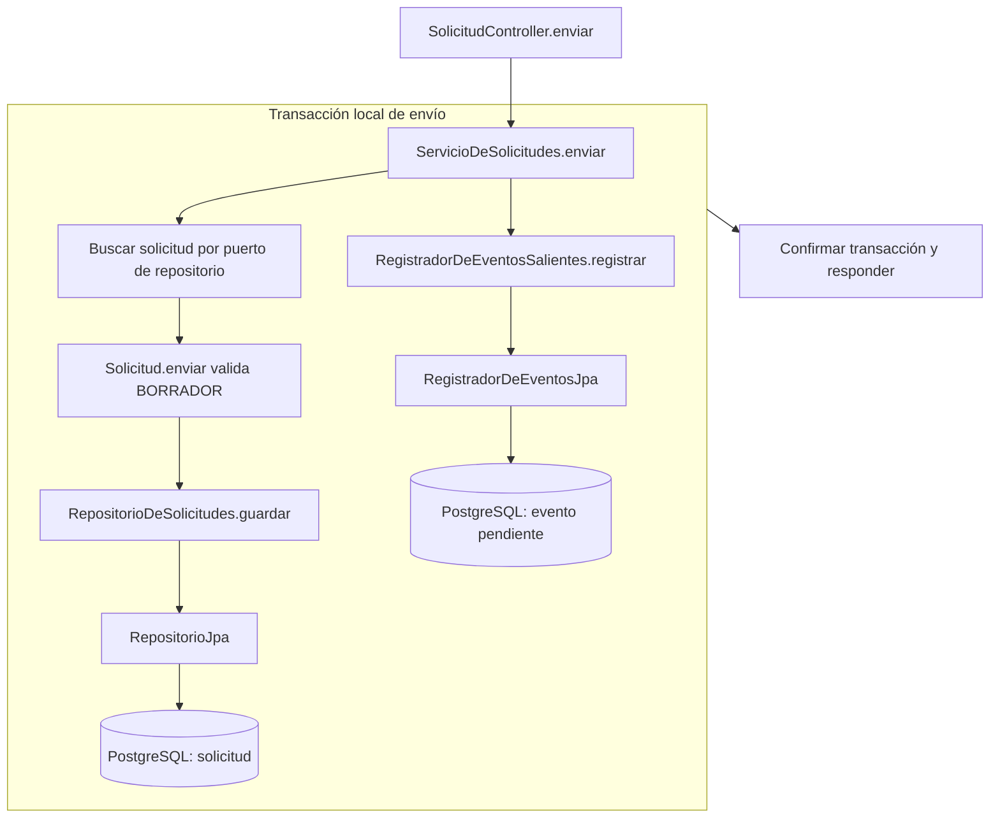
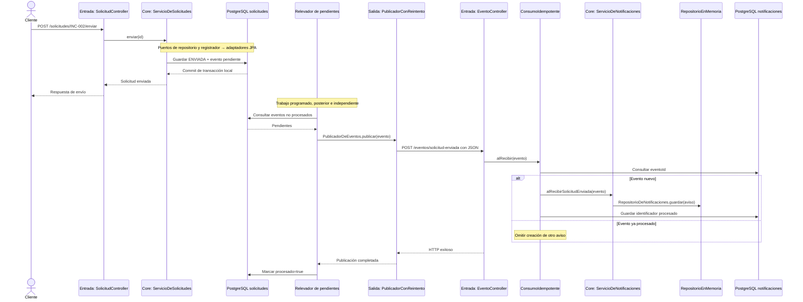
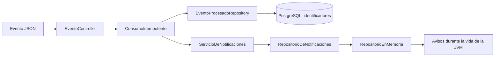

# Arquitectura hexagonal y flujo de datos

Este documento contiene los diagramas editables en Mermaid y la explicación que acompaña a ambas presentaciones. Las flechas continuas representan llamadas o transferencia de datos; las discontinuas representan implementación de contratos o dependencias de código, según la leyenda de cada diagrama.

## 1. El core y su frontera

El **core** contiene las reglas de negocio y los casos de uso que las coordinan. El dominio define qué significa enviar una solicitud y cuándo está permitido. Un puerto expresa una operación disponible o necesaria. Un adaptador traduce esa operación a una tecnología concreta.

La importancia de esta separación aparece al cambiar una tecnología: modificar HTTP o PostgreSQL no debería obligarnos a reescribir las reglas de transición. También permite probar las reglas sin iniciar un servidor o una base. No elimina la necesidad de pruebas de integración ni hace gratuitos los cambios de contrato.



Este es el **patrón conceptual**. Un puerto de entrada puede expresarse con una interfaz como `EnviarSolicitud`, y el caso de uso puede implementarla. En ARKA-Lite esa interfaz separada no existe: el controlador llama a `ServicioDeSolicitudes.enviar` directamente. Las interfaces de salida sí están definidas en el código.

## 2. Interfaces y dirección de las dependencias



Este diagrama muestra **dependencias de código**, no un recorrido temporal. El caso de uso conoce el contrato de salida; el adaptador también conoce ese contrato y lo implementa. El core no necesita importar la clase JPA. En ejecución, Spring conecta el contrato con una instancia concreta y la llamada sí llega al adaptador.

Una interfaz Java es un contrato de métodos, tipos y comportamiento esperado. No es una pantalla, una API HTTP ni un puerto de red. Cambiar un adaptador exige mantener el contrato, incluida la interpretación de ausencia, errores y resultados.

## 3. Recorrido real dentro de solicitudes



| Paso | Qué recibe | Qué hace | Qué entrega |
| --- | --- | --- | --- |
| Adaptador de entrada | Ruta HTTP con `INC-002` | Extrae el parámetro | `String id` al caso de uso |
| Caso de uso | Identificador | Solicita la búsqueda y trata la ausencia | Una `Solicitud` o excepción |
| Interfaz de salida | Identificador | Define el contrato `buscar` | `Optional<Solicitud>` |
| Adaptador JPA | Llamada al contrato | Consulta mediante Spring Data y convierte la entidad | Objeto de dominio |
| Adaptador de entrada, al volver | Objeto de dominio | Spring lo serializa | Respuesta JSON |

RepositorioQueRegistra es un adaptador alternativo en memoria con LinkedHashMap y mensajes en consola. El seleccionado para PostgreSQL es RepositorioJpa, marcado con @Primary. Cambiar almacenamiento exige además revisar configuración, esquema, migraciones y pruebas.

La interfaz no convierte ni almacena datos: la implementación realiza el trabajo. El retorno recorre las llamadas en sentido inverso. `RepositorioJpa.aDominio` convierte `SolicitudEntity` en `Solicitud`; no se entrega directamente una fila SQL al cliente.



## 4. El envío y la transacción local



Primero se busca la solicitud, se valida y se guarda como enviada; después se registra el evento. El dibujo muestra dos caminos de persistencia dentro de la misma transacción, no dos trabajos concurrentes. `@Transactional` en `ServicioDeSolicitudes.enviar` agrupa el cambio de estado y el outbox. Si falla uno, no debe confirmarse ninguno de esos cambios de esa transacción. La entrega HTTP se realiza posteriormente y no forma parte de ella.

El registro del evento contiene un UUID, `solicitudId`, `tipo` y `procesado=false`. El ID de la fila de base de datos y el UUID del evento son conceptos distintos.

## 5. Flujo completo entre servicios



El relevador espera cinco segundos **entre ciclos**. El publicador realiza hasta tres intentos por publicación. Si la entrega falla, el relevador deja el evento pendiente. Si el receptor procesó el evento pero se pierde la respuesta, puede producirse otra entrega con el mismo UUID. No hay un broker ni una transacción distribuida que confirme ambos servicios al mismo tiempo.

## 6. El core de notificaciones y sus salidas



`ConsumoIdempotente` coordina la comprobación del identificador. `ServicioDeNotificaciones` construye el texto y usa su puerto de almacenamiento. El adaptador activo de ese puerto guarda los avisos en una lista en memoria. El registro de identificadores usa JPA directamente desde el coordinador: este acceso no está aislado por un puerto propio del dominio.

`GET /notificaciones` recorre `NotificacionController → ServicioDeNotificaciones.listar → RepositorioDeNotificaciones.todas → RepositorioEnMemoria`; luego devuelve los avisos como JSON. `GET /eventos/procesados` consulta los identificadores persistidos. Son consultas distintas y pueden mostrar resultados diferentes después de reiniciar notificaciones.

## 7. Contrato real y transformaciones

```json
{
  "eventoId": "29bc873c-b86d-44b5-9302-707bb7a27106",
  "id": "INC-002",
  "tipo": "SolicitudEnviada"
}
```

El UUID es ilustrativo. En el flujo del outbox actual, `tipo` toma el valor `SolicitudEnviada`; no conserva el tipo de solicitud `Incidencia`. Ambos servicios tienen su propio record `SolicitudEnviada` y comparten la estructura del JSON, no una instancia Java.

| Frontera | Transformación |
| --- | --- |
| HTTP de entrada | Parámetro de ruta → `String id` |
| Dominio | `Solicitud` en borrador → nueva `Solicitud` enviada |
| Persistencia | `Solicitud` ↔ `SolicitudEntity` |
| Outbox | Identificador y hecho ocurrido → `EventoEntity` |
| Red | Evento pendiente → record → JSON → record del receptor |
| Aviso | Evento → `Notificacion` con texto → lista en memoria |

## 8. Qué mejora hexagonal y qué no resuelve sola

- Permite cambiar el adaptador de persistencia preservando las reglas y el contrato.
- Facilita pruebas rápidas del dominio con implementaciones en memoria.
- Ayuda a localizar cambios: formato HTTP en entrada, SQL en persistencia y reglas en el core.
- No garantiza entrega, idempotencia, seguridad ni rendimiento por la organización de carpetas.
- No garantiza independencia total si el core importa infraestructura o si los adaptadores se usan directamente.

Límites actuales: `ServicioDeSolicitudes` usa una anotación transaccional; el relevador accede directamente a JPA; el consumidor no guarda el aviso en la misma base que el identificador. La deduplicación actual no garantiza exactamente una vez bajo concurrencia. Al reiniciar notificaciones se pierden sus textos y repetir un ID ya procesado no los reconstruye.

## 9. Referencias al código

Las rutas siguientes son la base para verificar los guiones; no son una propuesta de nuevas clases.

- [Solicitud y reglas](../../servicio-solicitudes/src/main/java/pa/gob/dntic/serviciosolicitudes/dominio/Solicitud.java).
- [Caso de uso y transacción](../../servicio-solicitudes/src/main/java/pa/gob/dntic/serviciosolicitudes/dominio/ServicioDeSolicitudes.java).
- [Controlador de entrada](../../servicio-solicitudes/src/main/java/pa/gob/dntic/serviciosolicitudes/adaptadores/entrada/SolicitudController.java).
- [Interfaz del repositorio](../../servicio-solicitudes/src/main/java/pa/gob/dntic/serviciosolicitudes/dominio/RepositorioDeSolicitudes.java).
- [Adaptador JPA](../../servicio-solicitudes/src/main/java/pa/gob/dntic/serviciosolicitudes/adaptadores/persistencia/RepositorioJpa.java).
- [Registro del outbox](../../servicio-solicitudes/src/main/java/pa/gob/dntic/serviciosolicitudes/adaptadores/persistencia/RegistradorDeEventosJpa.java).
- [Relevador](../../servicio-solicitudes/src/main/java/pa/gob/dntic/serviciosolicitudes/adaptadores/salida/RelevadorDeEventosPendientes.java).
- [Publicador HTTP activo](../../servicio-solicitudes/src/main/java/pa/gob/dntic/serviciosolicitudes/adaptadores/salida/PublicadorConReintento.java).
- [Entrada de eventos](../../servicio-notificaciones/src/main/java/pa/gob/dntic/servicionotificaciones/adaptadores/entrada/EventoController.java).
- [Control de duplicados](../../servicio-notificaciones/src/main/java/pa/gob/dntic/servicionotificaciones/adaptadores/entrada/ConsumoIdempotente.java).
- [Core de notificaciones](../../servicio-notificaciones/src/main/java/pa/gob/dntic/servicionotificaciones/dominio/ServicioDeNotificaciones.java).

Volver a los [guiones](README.md).

Para explicarlo paso a paso, usar la pestaña Ayuda de [arka-lite-ui](../../arka-lite-ui/README.md) o los guiones de [presentation-data](../presentation-data/README.md).
