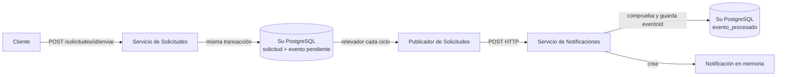

# ARKA-Lite

ARKA-Lite es una aplicación de ejemplo con dos microservicios Spring Boot. Un cliente crea y envía solicitudes; el Servicio de Solicitudes publica un evento por HTTP al Servicio de Notificaciones. En la rama actual, cada servicio tiene su propia base PostgreSQL.

| Servicio | Responsabilidad | BD propia | Puerto en Compose |
|---|---|---|---|
| `servicio-solicitudes` | Crear, consultar, enviar, aprobar y rechazar solicitudes; conservar eventos salientes pendientes. | `db-solicitudes`: tablas `solicitud` y `evento`. | `8080` |
| `servicio-notificaciones` | Recibir eventos y evitar procesar dos veces el mismo ID. | `db-notificaciones`: tabla `evento_procesado`. La notificación como objeto sigue en memoria. | `8081` |

## Código vigente

Cada servicio tiene su propio `pom.xml`, Maven Wrapper, `Dockerfile`, código y pruebas. Los archivos de Maven y `src/` de la raíz pertenecen al monolito anterior y no se usan para ejecutar estos microservicios.

```text
compose.yaml
k8s/
├── db-solicitudes.yaml
├── db-notificaciones.yaml
├── solicitudes.yaml
└── notificaciones.yaml
servicio-solicitudes/
servicio-notificaciones/
docs/
```

El proyecto usa Java 26, Spring Boot 4.1.1, Maven Wrapper, Spring Web MVC, Spring Data JPA, PostgreSQL 17, Docker y Kubernetes local con Docker Desktop. Los valores efectivos se consultan en los `pom.xml`, `Dockerfile`, `compose.yaml` y manifiestos de `k8s/`.

## Qué ocurre al enviar una solicitud



1. Solicitudes cambia el estado a `ENVIADA` y guarda un evento con `procesado=false` en **su** PostgreSQL dentro de una transacción.
2. Devuelve la respuesta al cliente sin esperar el POST a Notificaciones.
3. Un relevador de Solicitudes consulta la tabla `evento` y publica cada pendiente por HTTP, con hasta tres intentos por ciclo. Si fallan, el evento continúa pendiente.
4. Notificaciones consulta **su** tabla `evento_procesado`. Si el ID es nuevo, crea una notificación en memoria y guarda el ID en PostgreSQL. Si ya existe, no crea otra.
5. Tras un POST exitoso, Solicitudes marca el evento como procesado.

**La comunicación entre microservicios sigue siendo HTTP.** El outbox permite conservar y reintentar eventos salientes; no convierte la conexión en un bus de mensajes. La explicación con comparativas desde `main` está en [Evolución de eventos y outbox](../arquitectura/especificacion-eventos-outbox.md).

## API relevante

| Servicio | Método y ruta | Función |
|---|---|---|
| Solicitudes | `GET /solicitudes` y `GET /solicitudes/{id}` | Listar o consultar. |
| Solicitudes | `POST /solicitudes/crear` | Crear la solicitud demostrativa fija `INC-002`. |
| Solicitudes | `POST /solicitudes/{id}/enviar` | Marcar como enviada y guardar el evento pendiente. |
| Solicitudes | `POST /solicitudes/{id}/aprobar` y `/rechazar` | Cambiar el estado cuando la transición sea válida. |
| Notificaciones | `POST /eventos/solicitud-enviada` | Recibir y deduplicar el evento. |
| Notificaciones | `GET /eventos/procesados` | Listar ID ya recibidos. |
| Notificaciones | `GET /notificaciones` | Listar las notificaciones que están en memoria. |

Con Compose, Swagger UI queda en `http://localhost:8080/swagger-ui/index.html` y `http://localhost:8081/swagger-ui/index.html`.

## Ejecutar con Docker Compose

Desde la raíz del repositorio:

```powershell
docker compose config
docker compose up --build -d
docker compose ps
```

Probar el flujo:

```powershell
Invoke-RestMethod -Method Post http://localhost:8080/solicitudes/crear
Invoke-RestMethod -Method Post http://localhost:8080/solicitudes/INC-002/enviar
Start-Sleep -Seconds 6
Invoke-RestMethod http://localhost:8081/notificaciones
Invoke-RestMethod http://localhost:8081/eventos/procesados
docker compose logs servicio-solicitudes servicio-notificaciones
```

La espera permite observar un ciclo del relevador; no garantiza un tiempo exacto de entrega. Detener con `docker compose down`. El `compose.yaml` actual no define volúmenes persistentes para PostgreSQL, por lo que recrear los contenedores de BD puede eliminar sus datos. Ver [Docker y Compose](../operaciones/docker-y-compose.md).

## Ejecutar en Kubernetes local

La guía [Kubernetes local](../operaciones/kubernetes-local.md) contiene el orden de aplicación, `port-forward`, consultas y diagnóstico. [PostgreSQL en Kubernetes](../operaciones/postgresql-kubernetes.md) explica los PVC, `Secret`, `Deployment` y `Service` de cada base.

## Compilar y probar

Con JDK 26, desde la raíz:

```powershell
Push-Location servicio-solicitudes
.\mvnw.cmd clean verify
Pop-Location

Push-Location servicio-notificaciones
.\mvnw.cmd clean verify
Pop-Location
```

Para arrancar desde Maven fuera de Docker se necesitan PostgreSQL accesibles en `localhost:5432` (`db-solicitudes`) y `localhost:5433` (`db-notificaciones`), o definir `DB_URL`, `DB_USER` y `DB_PASSWORD` para cada proceso. Notificaciones debe usar un puerto HTTP distinto al 8080 de Solicitudes, por ejemplo `--server.port=8081`; consultar [Instalación y depuración](instalacion-y-debug.md).

## Límites actuales

- Las notificaciones como objetos no se guardan en PostgreSQL. El ID procesado sí persiste, por lo que reiniciar Notificaciones puede perder el objeto y conservar el ID.
- `POST /solicitudes/crear` usa un ID y tipo fijos, adecuados solo para demostración.
- Al arrancar Solicitudes, la carga de ejemplo vuelve a guardar `INC-001` y `CAM-002` y vuelve a enviar `CAM-002`; con una BD persistente puede restablecer sus estados y generar otro evento.
- No hay autenticación ni autorización.
- La tabla `evento` de una instalación anterior necesita migración para agregar `evento_id` y `procesado`; `CREATE TABLE IF NOT EXISTS` no altera una tabla ya existente.
- El relevador no coordina varias réplicas ni registra la causa de los errores capturados.

Consultar [Componentes Java](../arquitectura/componentes-java.md) y [especificación del flujo](../arquitectura/especificacion-eventos-outbox.md) para las clases y compromisos de diseño.
