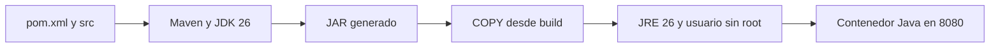
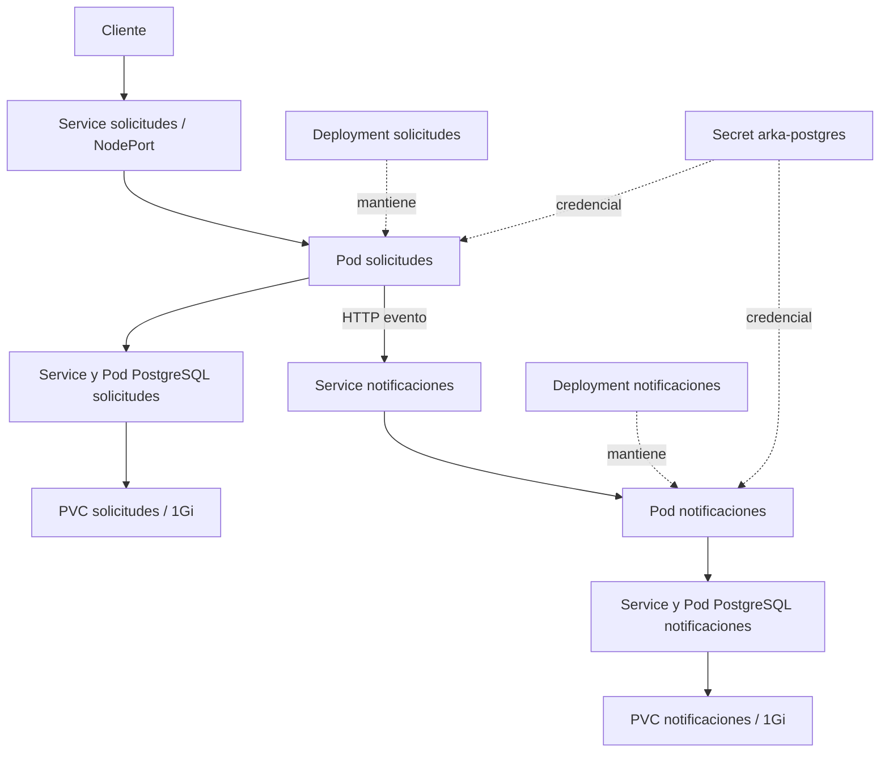
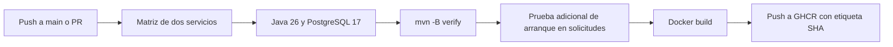
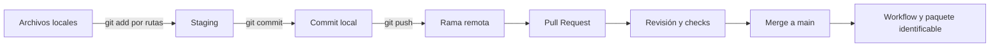

# Infraestructura y entrega de ARKA-Lite

Complemento de las secciones 4 a 7 de ambas presentaciones. Los diagramas de PowerPoint permanecen editables en `diagramas.mjs`.

## Docker: construcción multietapa

Los Dockerfile omiten pruebas durante `package`. El workflow ejecuta `verify` antes de construir la imagen. Compose publica solicitudes en 8080 y notificaciones en 8081, ambas con puerto interno 8080. El archivo actual no declara volúmenes de datos para PostgreSQL.

## Kubernetes: aplicaciones y almacenamiento

Readiness controla la recepción de tráfico. Los initContainers esperan dependencias al iniciar. Las bases tienen probes de readiness y liveness. Las aplicaciones solo declaran readiness. El almacenamiento de notificaciones conserva identificadores consumidos, mientras el texto del aviso permanece en memoria.

## Pipeline implementado

El job de notificaciones no realiza la comprobación adicional de arranque. El login precede al build. La publicación también se intenta en PR y puede fallar por permisos. No hay despliegue automático a Kubernetes.

## Promoción propuesta

```mermaid
flowchart LR
    Imagen[Imagen identificada por digest] --> Desarrollo
    Desarrollo --> Integracion[Pruebas de integración y recuperación]
    Integracion --> Preproduccion
    Preproduccion --> Aprobacion[Aprobación de producción]
    Aprobacion --> Produccion
    Produccion --> Comprobar[Salud y recorrido de negocio]
    Comprobar -->|Fallo y compatibilidad de datos| Rollback[Versión anterior identificada]
```

Esta promoción es una propuesta. Cambia la configuración por destino y conserva la misma imagen. El rollback de aplicación requiere comprobar compatibilidad de datos y contratos.

## Git y colaboración

La protección de main y los checks requeridos se presentan como propuestas, sin afirmar que estén configurados en GitHub.

## Fuentes

Configuración revisada: `compose.yaml`, Dockerfile de ambos servicios, `k8s/*.yaml` y `.github/workflows/ci.yml`.

- [Docker: builds multietapa](https://docs.docker.com/build/building/multi-stage/)
- [Kubernetes: Deployments](https://kubernetes.io/docs/concepts/workloads/controllers/deployment/)
- [GitHub Actions: conceptos](https://docs.github.com/en/actions/get-started/understand-github-actions)
- [Git: modelo e historial](https://git-scm.com/book/en/v2/Getting-Started-What-is-Git%3F)
