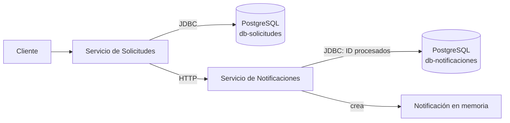

# Kubernetes local con Docker Desktop

Esta guía levanta **dos aplicaciones y dos PostgreSQL independientes**. Todos los comandos PowerShell se ejecutan desde la raíz del repositorio. Para entender cada manifiesto de base de datos, consultar [PostgreSQL en Kubernetes](postgresql-kubernetes.md).

## Antes de empezar

Habilitar Kubernetes en Docker Desktop y esperar a que indique que está listo. Comprobar el contexto antes de aplicar recursos para no desplegar en otro clúster:

```powershell
kubectl config get-contexts
kubectl config use-context docker-desktop
kubectl cluster-info
kubectl get nodes
```

Las credenciales `arka/arka` del `Secret` son solo para el laboratorio local. Los manifiestos usan las imágenes `servicio-solicitudes:local` y `servicio-notificaciones:local`; construirlas con esas etiquetas:

```powershell
docker build -t servicio-solicitudes:local .\servicio-solicitudes
docker build -t servicio-notificaciones:local .\servicio-notificaciones
docker image ls servicio-solicitudes:local
docker image ls servicio-notificaciones:local
```

## Orden de los cuatro archivos

| Archivo | Qué crea | Depende de |
|---|---|---|
| `k8s/db-solicitudes.yaml` | `Secret` local, PVC, `Deployment` y `Service` de PostgreSQL para Solicitudes. | Almacenamiento disponible en el clúster. |
| `k8s/db-notificaciones.yaml` | PVC, `Deployment` y `Service` de PostgreSQL para Notificaciones. | El `Secret` `arka-postgres` del primer archivo. |
| `k8s/notificaciones.yaml` | `Deployment` y `Service` de Notificaciones. | `db-notificaciones` accesible. |
| `k8s/solicitudes.yaml` | `Deployment` y `Service` de Solicitudes. | `db-solicitudes` y el endpoint de Notificaciones accesibles. |



Los dos PostgreSQL tienen servicios DNS distintos dentro del clúster. Notificaciones **no** usa la BD de Solicitudes. Su BD guarda `evento_procesado`; la notificación todavía se guarda en memoria.

## Desplegar y comprobar

Si este clúster ya ejecutó los manifiestos de `main`, comprobar primero si sigue el `Deployment` anterior `base-datos`. El nuevo `db-solicitudes` usa **el mismo PVC** `arka-postgres-data`; no deben ejecutarse las dos instancias PostgreSQL sobre esos datos. Detener el recurso anterior sin borrar el PVC:

```powershell
kubectl get deployment base-datos
kubectl delete deployment base-datos --ignore-not-found
kubectl delete service base-datos --ignore-not-found
```

Si `kubectl get` responde `NotFound`, continuar. El volumen anterior puede contener la base `arka` en lugar de `db-solicitudes`; leer [migración de la base](postgresql-kubernetes.md#diagnóstico) antes de iniciar las aplicaciones con datos que se quieran conservar.

Aplicar los archivos por dependencia. `kubectl apply -R -f k8s/` también es posible, pero el orden explícito facilita localizar errores:

```powershell
kubectl apply -f k8s/db-solicitudes.yaml
kubectl apply -f k8s/db-notificaciones.yaml
kubectl rollout status deployment/db-solicitudes --timeout=120s
kubectl rollout status deployment/db-notificaciones --timeout=120s

kubectl apply -f k8s/notificaciones.yaml
kubectl rollout status deployment/servicio-notificaciones --timeout=120s
kubectl apply -f k8s/solicitudes.yaml
kubectl rollout status deployment/servicio-solicitudes --timeout=120s

kubectl get deployments,pods,services,pvc
```

`rollout status` espera a que los pods estén listos. Si un PVC permanece en `Pending`, consultar [diagnóstico de PostgreSQL](postgresql-kubernetes.md#diagnóstico).

## Probar el flujo

Abrir dos terminales y mantener un `port-forward` en cada una:

```powershell
kubectl port-forward service/servicio-solicitudes 18080:8080
```

```powershell
kubectl port-forward service/servicio-notificaciones 18081:8080
```

En una tercera terminal:

```powershell
Invoke-RestMethod http://localhost:18080/solicitudes
Invoke-RestMethod -Method Post http://localhost:18080/solicitudes/crear
Invoke-RestMethod -Method Post http://localhost:18080/solicitudes/INC-002/enviar
Start-Sleep -Seconds 6
Invoke-RestMethod http://localhost:18081/notificaciones
Invoke-RestMethod http://localhost:18081/eventos/procesados
```

El envío devuelve `ENVIADA` antes de la publicación HTTP. El relevador de Solicitudes lee los eventos pendientes con `fixedDelay=5000`; esperar seis segundos es una ayuda para la prueba, no una garantía exacta de tiempo. Los Swagger UI están en `http://localhost:18080/swagger-ui/index.html` y `http://localhost:18081/swagger-ui/index.html`.

Para comprobar las filas directamente en cada PostgreSQL:

```powershell
kubectl exec deployment/db-solicitudes -- psql -U arka -d db-solicitudes -c 'SELECT id, solicitud_id, evento_id, procesado FROM evento ORDER BY id;'
kubectl exec deployment/db-notificaciones -- psql -U arka -d db-notificaciones -c 'SELECT evento_id FROM evento_procesado;'
```

El primer comando lee **la BD de Solicitudes** (eventos salientes); el segundo lee **la BD de Notificaciones** (ID ya recibidos). Cerrar cada `port-forward` con `Ctrl+C`.

## Ver estado y diagnosticar

```powershell
kubectl get pods -o wide
kubectl get pvc
kubectl describe pod -l app=db-solicitudes
kubectl describe pod -l app=db-notificaciones
kubectl logs deployment/db-solicitudes --tail=100
kubectl logs deployment/db-notificaciones --tail=100
kubectl logs deployment/servicio-solicitudes --tail=100
kubectl logs deployment/servicio-notificaciones --tail=100
```

Un `initContainer` de cada aplicación espera a su PostgreSQL; el de Solicitudes también espera la API de Notificaciones. Si un pod queda en `Init`, revisar primero el pod y el `Service` del que depende. Los detalles están en [PostgreSQL en Kubernetes](postgresql-kubernetes.md#diagnóstico).

## Actualizar una imagen local

Los manifiestos usan `imagePullPolicy: IfNotPresent`. Reconstruir la etiqueta `:local` y reiniciar un `Deployment` puede reutilizar una imagen anterior ya almacenada en el nodo. Para una actualización inequívoca, usar una **etiqueta nueva** y asignarla al contenedor:

```powershell
docker build -t servicio-solicitudes:prueba-2 .\servicio-solicitudes
kubectl set image deployment/servicio-solicitudes servicio-solicitudes=servicio-solicitudes:prueba-2
kubectl rollout status deployment/servicio-solicitudes --timeout=120s
```

En Docker Desktop, confirmar que el clúster puede ver la imagen local. Si aparece `ImagePullBackOff`, ejecutar `kubectl describe pod -l app=servicio-solicitudes` y revisar los eventos; la disponibilidad de imágenes locales depende de la configuración del almacén de imágenes de Docker Desktop. Para volver al manifiesto, aplicar de nuevo `k8s/solicitudes.yaml`.

Para detener los recursos y decidir si se conservan los datos, seguir [Limpieza de Kubernetes local](kubernetes-limpieza.md).
