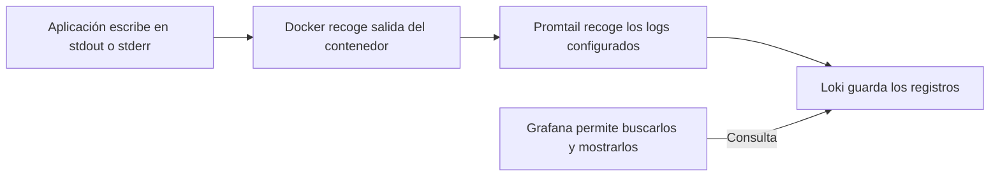
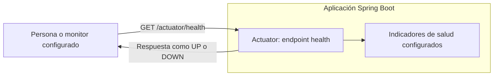
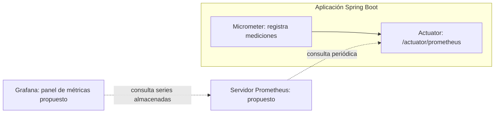
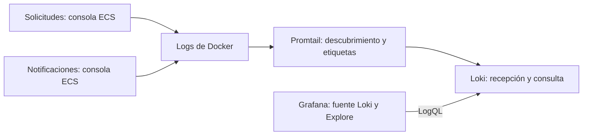
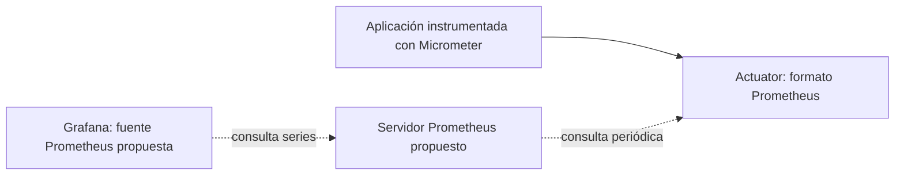
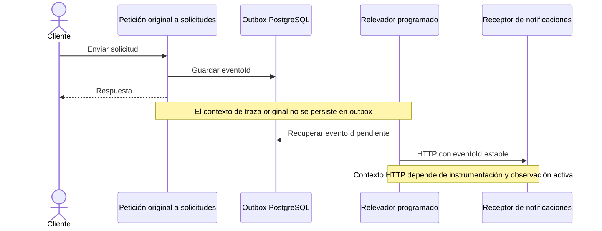

# Observabilidad

Sección 9 de los guiones: equipo, unidades 58–65; staff, 33–36. Contenido Markdown para preparar la presentación, sin generación de PowerPoint ni cambios de infraestructura.

## Alcance de herramientas

La sección explica Grafana, Loki, Promtail, Prometheus, Actuator y Micrometer. Cada herramienta tiene una responsabilidad diferente. Actuator y Micrometer forman parte de las aplicaciones; Grafana, Loki y Promtail se ejecutan como contenedores separados. Un servidor Prometheus sigue pendiente de incorporar.

| Pieza | Función | Estado verificado |
| --- | --- | --- |
| Grafana | Consultar fuentes y visualizar resultados | Compose, puerto 3000, sin fuente Loki aprovisionada |
| Loki | Recibir y consultar logs | Compose, puerto 3100 |
| Promtail | Descubrir contenedores y enviar logs a Loki | observabilidad/promtail.yaml, etiquetas container, project y service |
| Actuator | Exponer salud y endpoints de métricas | Dependencias y propiedades de ambos servicios |
| Micrometer | Instrumentar métricas y contexto de trazas | Registro Prometheus y puente Brave declarados |
| Prometheus | Recoger y conservar métricas como series | Endpoint de exposición disponible por configuración, servidor ausente en Compose |
| Backend de trazas | Almacenar y explorar spans | No configurado en Compose |

Promtail es el agente existente del laboratorio. Su soporte terminó el 2 de marzo de 2026. Documentar su migración a Alloy u otro agente soportado como propuesta, sin presentarla como aplicada. [Estado oficial de Promtail](https://grafana.com/docs/loki/latest/send-data/promtail/).

## Explicación inicial: qué es cada cosa

### Promtail y los archivos del sistema

Un **log** es un registro de un hecho: por ejemplo, un error al conectar a PostgreSQL. Puede escribirse en consola, en un archivo de la aplicación o en un registro del sistema operativo. Un archivo llamado `system.log` contiene logs: no es una categoría adicional a los logs.

Promtail puede recoger distintas fuentes cuando se configuran: salida de contenedores Docker, archivos accesibles o mensajes de syslog. Los nombres `system.log`, `/var/log/syslog` o `/var/log/messages` son ejemplos dependientes del sistema, no rutas universales. Syslog también puede referirse a un protocolo de recepción de mensajes, distinto de leer un archivo.

**En ARKA-Lite, Promtail está configurado únicamente para descubrir contenedores Docker.** El YAML no declara rutas de archivos del host ni un receptor syslog; Compose tampoco monta un directorio de logs del sistema dentro de Promtail. Montar Docker socket no concede automáticamente lectura de todos los archivos del equipo. Para recoger un archivo habría que hacerlo accesible al agente y configurar expresamente su lectura. Eso no se implementa con esta documentación.

El System.err del publicador es otra cosa: escribe en la salida de error del proceso Java. Docker puede recoger esa salida junto con la salida estándar del contenedor. No es un archivo `system.log` ni el log del sistema operativo.



**Frase para exponer:** la aplicación escribe, Promtail recoge, Loki guarda y Grafana muestra.

### Actuator, health y Micrometer dentro de la aplicación

**Actuator** es un módulo de Spring Boot que se añade a la aplicación para ofrecer información operativa mediante URLs. **health** es uno de esos endpoints. No es otro servidor ni una herramienta que se instale dentro de Grafana. [Endpoints de Actuator](https://docs.spring.io/spring-boot/reference/actuator/endpoints.html).

| URL del servicio de solicitudes | Qué permite consultar | Ejemplo de pregunta |
| --- | --- | --- |
| `/actuator/health` | Resultado de indicadores de salud configurados | ¿Qué salud informa ahora esta aplicación? |
| `/actuator/metrics` | Nombres y consulta diagnóstica de métricas | ¿Qué mediciones produce? |
| `/actuator/prometheus` | Métricas en formato de recolección | ¿Qué series puede recoger Prometheus? |

Ejemplo ilustrativo de una respuesta resumida de health, no una lectura real del entorno:

```json
{"status":"UP"}
```

UP resume los indicadores que participan en esa consulta. Los detalles y componentes dependen de la configuración. Puede incluir comprobaciones de dependencias disponibles, como la base de datos, pero no descubre automáticamente todos los servicios de un sistema ni demuestra que cada solicitud terminó correctamente.

**Micrometer** aporta instrumentación y registro de mediciones, como duración o número de peticiones. Actuator permite exponer esa información por HTTP. Para comprobar `health` podemos abrir la URL en un navegador o usar PowerShell, sin necesitar Grafana:

```powershell
Invoke-RestMethod http://localhost:8080/actuator/health
```

El comando es un ejemplo de lectura, sin ejecutar durante la edición del guion.



### Loki no requiere Actuator ni health

Loki recibe logs de agentes o clientes configurados, como Promtail en este laboratorio. Actuator es un módulo opcional de la aplicación Spring Boot y health es uno de sus endpoints. Son una ruta de información distinta de los logs y no constituyen requisitos generales para usar Loki.

### Cómo llega información a Grafana

Grafana consulta **fuentes de datos que se hayan conectado**. Para logs se conecta con Loki. Una integración habitual de métricas conecta Grafana con un servidor Prometheus, que consulta periódicamente `/actuator/prometheus` de las aplicaciones. [Fuentes de datos de Grafana](https://grafana.com/docs/grafana/latest/datasources/).



Las flechas discontinuas requieren configuración adicional. **Grafana no consulta automáticamente Actuator ni health por añadir el módulo al proyecto.** Mostrar estado de servicios exige definir cómo se recoge ese estado y cómo se presenta: por ejemplo, un monitor HTTP configurado y un panel sobre sus resultados. Esa integración no existe en los archivos actuales.

### Salud de aplicación, chequeo del contenedor y servicio de negocio

| Comprobación | Quién la ejecuta aquí | Qué mira en la configuración actual |
| --- | --- | --- |
| Actuator health | Quien consulta su URL | Indicadores de salud de la aplicación |
| Healthcheck de notificaciones en Compose | Docker | Si puede abrir una conexión TCP al puerto 8080 |
| Healthcheck de PostgreSQL en Compose | Docker | Resultado de pg_isready |
| Readiness de solicitudes en Kubernetes | Kubernetes | Respuesta HTTP de `/solicitudes` |
| Readiness de notificaciones en Kubernetes | Kubernetes | Respuesta HTTP de `/notificaciones` |
| Verificar entrega de INC-002 | Consulta de negocio y diagnóstico | Estado, outbox, consumo y texto disponible |

Los chequeos actuales de Compose y Kubernetes no llaman a `/actuator/health` de las aplicaciones. Compartir palabras como health o readiness no significa que todos ejecuten la misma prueba. Un puerto accesible, una API que responde y un evento de negocio completado son comprobaciones diferentes.

**Ejemplo para explicar:** notificaciones puede responder health con UP y, aun así, no tener el texto de un aviso porque se reinició y el texto estaba en memoria. Se necesita consultar ese aviso o sus datos para comprobar el resultado del negocio.

## 1. Señales y preguntas

| Señal | Pregunta | Ejemplo |
| --- | --- | --- |
| Log | ¿Qué ocurrió? | Intento de publicar evento y error HTTP |
| Métrica | ¿Cuánto y con qué frecuencia? | Volumen y duración agregada de peticiones |
| Traza | ¿Qué operaciones participaron en una ejecución? | Span HTTP y llamadas instrumentadas |
| Dato de negocio | ¿Qué hecho quedó confirmado? | Estado ENVIADA y evento pendiente |

Un endpoint saludable no prueba que un aviso particular exista. Un log de intento tampoco demuestra commit, y la ausencia de logs puede revelar un problema de recolección.

## 2. Ruta actual de logs



Promtail usa Docker socket y envía a `http://loki:3100/loki/api/v1/push`. El YAML agrega etiquetas `container`, `project` y `service`; no extrae automáticamente los identificadores de negocio como etiquetas. El publicador y el consumidor incluyen solicitudId y eventoId en mensajes. El publicador también usa System.err en un camino de fallo, por lo que no todas las líneas deben tratarse como JSON ECS.

### Guion para conectar Grafana con Loki

1. Abrir Grafana local en el puerto 3000.
2. En la administración de conexiones o fuentes de datos, agregar una fuente de tipo Loki. Los nombres del menú pueden variar según la versión y el idioma.
3. Usar `http://loki:3100` como URL desde Grafana ejecutándose en la red de Compose. localhost dentro de Grafana no apunta al contenedor Loki.
4. Guardar y probar la conexión.
5. Entrar en Explore, elegir la fuente y ajustar el intervalo temporal.
6. Confirmar las etiquetas disponibles antes de filtrar un servicio.

Es un procedimiento de demostración pendiente de ejecución. No se ha configurado ninguna fuente ni abierto una sesión de Grafana para redactar este material.

### Consultas LogQL de lectura

```logql
{service="servicio-solicitudes"} |= "INC-002"
{service="servicio-notificaciones"} |= "INC-002"
```

Para seguir una entrega concreta, sustituir el texto por el UUID observado en el outbox. Para ver ambos servicios en una consulta:

```logql
{service=~"servicio-solicitudes|servicio-notificaciones"} |= "29bc873c-b86d-44b5-9302-707bb7a27106"
```

El UUID es ilustrativo. El selector escoge streams y `|=` filtra líneas por contenido. Si no hay resultados, comprobar tiempo, etiquetas, logs de origen e ingestión antes de concluir que el hecho no ocurrió. [Consultas oficiales de LogQL](https://grafana.com/docs/loki/latest/query/log_queries/).

## 3. Métricas: exposición y recolección



Las líneas discontinuas son componentes o conexiones pendientes. Exponer `/actuator/prometheus` no crea un servidor Prometheus ni almacena históricos.

Guion de lectura para solicitudes local:

```powershell
Invoke-RestMethod http://localhost:8080/actuator/health
Invoke-RestMethod http://localhost:8080/actuator/metrics
(Invoke-WebRequest http://localhost:8080/actuator/prometheus).Content
```

Para notificaciones, usar el puerto publicado 8081 cuando se ejecuta mediante Compose. Los comandos son ejemplos sin ejecutar. Descubrir primero las métricas realmente disponibles antes de escribir un panel o una consulta; no asumir nombres, histogramas o valores observados.

## 4. Trazas y correlación



El proyecto declara Micrometer Tracing con Brave y crea el RestClient del publicador con un builder administrado por Spring. Eso permite instrumentación y propagación bajo las condiciones de observación aplicables, pero no demuestra que el request del usuario y todos los reintentos compartan una traza.

`solicitudId` y `eventoId` correlacionan negocio. `traceId` y `spanId` describen ejecución. No son intercambiables. La probabilidad de muestreo está a 1.0 en propiedades, sin backend de trazas configurado. Buscar un traceId en Loki es consultar logs correlacionados, no disponer de un explorador de spans. [Tracing en Spring Boot](https://docs.spring.io/spring-boot/reference/actuator/tracing.html).

### Propagación por headers de HTTP

La instrumentación puede insertar y extraer headers de contexto en peticiones HTTP, incluyendo GET y POST. El log permanece como registro local de cada servicio. W3C define, por ejemplo, traceparent; no se afirma que se haya capturado un header específico del laboratorio. El evento real viaja por POST y conserva eventoId en su JSON; el outbox no conserva el contexto de la petición original. [Estándar W3C Trace Context](https://www.w3.org/TR/trace-context/).

## 5. Caso guiado: solicitud enviada sin aviso

1. Consultar el estado de la solicitud y el outbox según [datos y consistencia](../arquitectura/datos-y-consistencia.md#7-guion-del-laboratorio).
2. Copiar el eventoId real y buscarlo en ambos servicios dentro del mismo intervalo.
3. Distinguir intento, error, consumo y omisión por duplicado.
4. Consultar IDs consumidos y textos disponibles por separado.
5. Si hubo reinicio del receptor, considerar que el ID sobrevive y el texto en memoria desaparece.
6. Contrastar logs con datos persistidos; no inferir un commit por un mensaje previo a su confirmación.

| Evidencia | Hipótesis que ayuda a investigar |
| --- | --- |
| Evento pendiente y errores HTTP | Receptor o red no disponibles |
| Repetición del mismo UUID | Reintento esperado o confirmación perdida |
| ID consumido y texto ausente tras reinicio | Límite de persistencia del aviso |
| Salud correcta y pendientes acumulados | Flujo de negocio incompleto |
| Sin logs en Loki pero con consola activa | Problema de ingestión o consulta |

Son hipótesis para contrastar, no diagnósticos automáticos.

## 6. Indicadores y alertas propuestos

- Volumen de peticiones, tasa de errores y duración HTTP.
- Cantidad de pendientes y fallos de entrega, mediante instrumentación por implementar.
- Antigüedad de pendientes: requiere una fecha que la tabla evento actual no tiene.
- Fallos de marcado del outbox: el relevador no registra expresamente ese camino en su catch.
- Ausencia de telemetría para detectar una recolección detenida.

No se han implementado dashboards, alertas, métricas de backlog ni objetivos SLO. Cada regla futura debe definir condición, intervalo, responsable y acción. Mantener identificadores únicos en contenido o campos de contexto en lugar de convertirlos en etiquetas de streams o métricas que crezcan con cada solicitud.

## 7. Criterios para validar la demostración

- Los logs reales de ambos servicios llegan a Loki con sus etiquetas.
- Grafana puede consultar la fuente y encontrar un UUID real.
- Los endpoints de Actuator responden en el entorno preparado.
- Se distingue formato Prometheus de servidor de series.
- Se explica el límite de correlación del outbox sin prometer una traza continua.
- Un fallo controlado produce evidencia que permite ubicar el paso pendiente.

## 8. Ejemplo didáctico de lectura de evidencia

Los registros siguientes son inventados para explicar el razonamiento. No son capturas del entorno ni reproducen el formato exacto del logger. El reloj y los IDs son ilustrativos.

```text
10:00:00 solicitudes   INC-002   EVT-DEMO-01   envío local confirmado
10:00:02 publicador    INC-002   EVT-DEMO-01   primer intento falla por conexión
10:00:03 publicador    INC-002   EVT-DEMO-01   siguiente intento recibe éxito
10:00:03 receptor      INC-002   EVT-DEMO-01   consumo registrado
```

**Qué explicar:** las líneas ayudan a proponer una secuencia. Todavía debemos comprobar en datos que la marca del emisor quedó guardada y que el texto está disponible. Un mensaje de confirmación del ejemplo no significa que exista un log equivalente en el código actual. No sumar ni restar estas horas como si fueran latencia real medida entre equipos sincronizados.

**Ejercicio:** si el receptor consumió, pero el emisor continúa con procesado=false, ¿qué puede pasar? Una nueva entrega del mismo UUID. El receptor debe tratar la repetición sin duplicar su efecto previsto.

## 9. Cómo leer métricas sin confundirlas con salud

| Concepto | Explicación para el público | Límite |
| --- | --- | --- |
| Contador | Acumula sucesos, como peticiones | Puede reiniciarse al reiniciar el proceso; una tasa necesita un intervalo |
| Gauge | Representa una medición de un momento, como pendientes | Requiere instrumentar y actualizar esa medición |
| Duración | Cuánto tarda una operación definida | Definir comienzo y fin: request HTTP y entrega completa no miden lo mismo |
| Percentil 95 | Valor bajo el que queda aproximadamente el 95% de observaciones del conjunto considerado | Depende del período, población y método de cálculo |
| Tasa de errores | Proporción o frecuencia de fallos según una definición | Especificar qué es error y cuál es el denominador |

No se muestran valores medidos ni se afirma que haya histogramas o percentiles configurados. Si se propone latencia de entrega de extremo a extremo, primero se necesitan instantes e identidad suficientes para definirla. El esquema actual no aporta fecha de creación del evento.

Una caída de la tasa de peticiones puede significar menor demanda o que las peticiones ya no llegan. Una gráfica sin datos puede significar falta de recolección. Las señales se interpretan juntas y con contexto.

## 10. Diseño de un dashboard explicado

Propuesta para una etapa posterior, sin paneles ni fuentes creados con este documento:

| Pregunta del panel | Fuente posible | Acción que orienta |
| --- | --- | --- |
| ¿La API recibe tráfico? | Métricas HTTP recogidas por Prometheus | Contrastar demanda y acceso |
| ¿Aumentan errores o duración? | Métricas HTTP instrumentadas | Revisar servicio y dependencias |
| ¿Se acumulan eventos? | Métrica de negocio por implementar | Revisar relevador, receptor y marcado |
| ¿Qué pasó con un UUID? | Logs de Loki | Seguir intentos y consumo |
| ¿La telemetría dejó de llegar? | Comprobaciones de recolección por configurar | Investigar agentes y fuentes |

Un panel debe decir qué mide, en qué unidad, con qué filtros y en qué intervalo. Evitar un semáforo general que mezcle puerto abierto, health, error de publicación y disponibilidad del aviso sin explicar el criterio.

## 11. Guion de preguntas frecuentes

**¿Loki guarda métricas de Prometheus?** En este material Loki es el backend de logs. Prometheus es la pieza propuesta para series de métricas. Las consultas sobre logs pueden producir agregaciones, pero eso no significa que esté configurada una recolección Prometheus.

**¿Una traza es cualquier línea que tenga traceId?** La línea puede correlacionarse con contexto, pero explorar una traza con spans exige la instrumentación, exportación y almacenamiento correspondientes.

**¿Podemos mostrar health en un panel?** Sí, mediante una integración que recoja y presente ese estado. No ocurre automáticamente al instalar Actuator o Grafana. Este proyecto todavía no configura esa integración.

**¿Readiness significa que todas las operaciones de negocio funcionan?** Informa si se cumple la comprobación configurada para recibir tráfico. El criterio concreto debe conocerse; no cubre automáticamente cada evento o dato.

**¿Dónde vemos el fallo si no hay logs?** Comprobar el origen y la ruta de recolección. Los datos persistidos, eventos de Kubernetes y salida de contenedores también aportan evidencia. No asumir salud por silencio.

**¿Por qué no usamos el eventoId como etiqueta para todo?** Porque crea un valor diferente por evento y puede multiplicar series o streams. Usarlo como contenido o contexto permite buscar casos sin esa multiplicación de etiquetas.

## Guion oral para ensayar

El texto para decir, las demostraciones y las preguntas de esta sección están en los guiones generados de [presentation-data](../presentation-data/README.md).

## Fuentes del proyecto

- [Compose: Grafana, Loki y Promtail](../../compose.yaml).
- [Descubrimiento y etiquetas de Promtail](../../observabilidad/promtail.yaml).
- [Dependencias de solicitudes](../../servicio-solicitudes/pom.xml).
- [Dependencias de notificaciones](../../servicio-notificaciones/pom.xml).
- [Propiedades de solicitudes](../../servicio-solicitudes/src/main/resources/application.properties).
- [Propiedades de notificaciones](../../servicio-notificaciones/src/main/resources/application.properties).
- [Construcción del cliente HTTP](../../servicio-solicitudes/src/main/java/pa/gob/dntic/serviciosolicitudes/config/PropagacionDeTraza.java).
- [Publicador y logs de reintentos](../../servicio-solicitudes/src/main/java/pa/gob/dntic/serviciosolicitudes/adaptadores/salida/PublicadorConReintento.java).

Volver al [índice de guiones](README.md).
