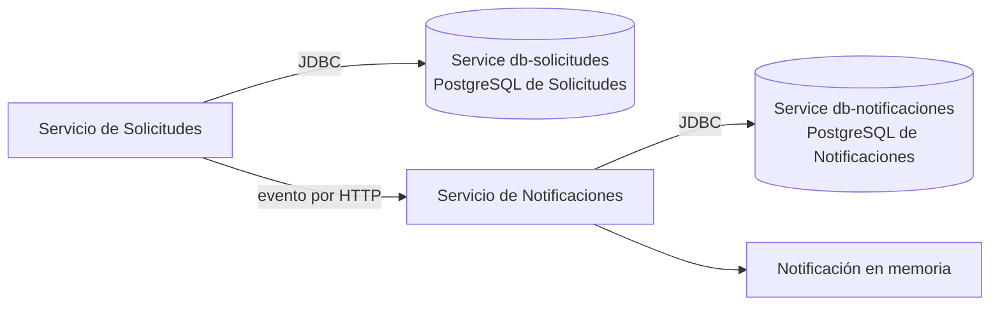

# PostgreSQL en Kubernetes: dos bases y cuatro tipos de recurso

Esta guía explica los manifiestos `k8s/db-solicitudes.yaml` y `k8s/db-notificaciones.yaml` tal como están en la rama actual. Cada microservicio tiene **su propio PostgreSQL**; las aplicaciones se comunican entre sí por HTTP, no compartiendo tablas. Para ejecutar el despliegue completo, empezar en [Kubernetes local](kubernetes-local.md).

## Mapa de los datos



| Propietario | BD y nombre DNS en Kubernetes | Tablas relevantes | Dato que permanece |
|---|---|---|---|
| Solicitudes | `db-solicitudes` | `solicitud`, `evento` | Solicitudes y eventos salientes pendientes o publicados. |
| Notificaciones | `db-notificaciones` | `evento_procesado` | ID de eventos recibidos. **Las notificaciones mismas siguen en memoria.** |

Dentro del clúster, `db-solicitudes` y `db-notificaciones` son nombres de recursos `Service` que resuelven a los pods PostgreSQL. El puerto de ambos es `5432` **dentro de la red de Kubernetes**; los manifiestos no publican directamente las bases en la computadora.

## Qué contiene cada archivo

### `k8s/db-solicitudes.yaml`

Contiene cuatro documentos YAML separados por `---`:

1. **`Secret arka-postgres`:** contraseña `arka` para desarrollo local. Ambos PostgreSQL y los `initContainers` la leen. No utilizar este valor de laboratorio fuera del entorno local.
2. **`PersistentVolumeClaim arka-postgres-data`:** solicita `1Gi` y acceso `ReadWriteOnce` para los datos de Solicitudes. El nombre todavía usa el prefijo antiguo `arka`; pertenece a **Solicitudes**.
3. **`Deployment db-solicitudes`:** ejecuta una réplica de `postgres:17`, crea inicialmente la BD `db-solicitudes` y monta el PVC. Usa estrategia `Recreate` para evitar dos pods escribiendo simultáneamente en el mismo volumen.
4. **`Service db-solicitudes`:** ofrece DNS y puerto estables al `Deployment`; selecciona los pods con `app: db-solicitudes`.

### `k8s/db-notificaciones.yaml`

Contiene tres documentos: `PersistentVolumeClaim notificaciones-postgres-data`, `Deployment db-notificaciones` y `Service db-notificaciones`. Solicita otro `1Gi`, usa otra instancia `postgres:17` y crea inicialmente la BD `db-notificaciones`. **No crea un segundo `Secret`:** usa `arka-postgres` del archivo de Solicitudes.

| Campo de los `Deployment` | Función en este proyecto |
|---|---|
| `POSTGRES_DB` | Nombre de la BD creada al inicializar un volumen vacío: `db-solicitudes` o `db-notificaciones`. |
| `POSTGRES_USER` | Usuario `arka`. |
| `POSTGRES_PASSWORD` | Valor leído del `Secret arka-postgres`, clave `password`. |
| `PGDATA` | Directorio `/var/lib/postgresql/data/pgdata` dentro del volumen montado. |
| `volumeMounts` y `volumes` | Montan el PVC en `/var/lib/postgresql/data`; los archivos PostgreSQL quedan fuera del ciclo de vida del contenedor. |
| `readinessProbe` | Usa `pg_isready` para indicar si el pod puede recibir conexiones. |
| `livenessProbe` | Usa `pg_isready` para decidir si Kubernetes debe reiniciar el contenedor. |
| `selector` y etiquetas `app` | Permiten que el `Service` encuentre el pod correcto. |

`pg_isready` comprueba disponibilidad del servidor, no que la aplicación haya creado todas las tablas. Los `initContainers` de las aplicaciones realizan una consulta `SELECT 1` con `psql` antes de arrancar.

## Cómo se conectan las aplicaciones

`k8s/solicitudes.yaml` define la URL `jdbc:postgresql://db-solicitudes:5432/db-solicitudes`. `k8s/notificaciones.yaml` usa `jdbc:postgresql://db-notificaciones:5432/db-notificaciones`. En ambos, `DB_USER=arka` y `DB_PASSWORD` se obtiene del mismo `Secret`.

El `initContainer esperar-db-solicitudes` no permite iniciar Solicitudes hasta poder consultar su BD. Solicitudes tiene además `esperar-notificaciones`, que espera la API HTTP del otro servicio. El `initContainer esperar-db-notificaciones` hace lo equivalente para Notificaciones.

No confundir estos tres nombres:

- **`Deployment`** mantiene el pod PostgreSQL.
- **`Service`** da un nombre de red estable al pod.
- **`POSTGRES_DB`** nombra la base *dentro* de PostgreSQL. En este proyecto coinciden las cadenas `db-solicitudes` y `db-notificaciones` por conveniencia.

## Comandos para inspeccionar

Desde la raíz del repositorio, con el contexto `docker-desktop` seleccionado:

```powershell
kubectl get secret arka-postgres
kubectl get storageclass
kubectl get pvc
kubectl get deployments db-solicitudes db-notificaciones
kubectl get services db-solicitudes db-notificaciones
kubectl get pods -l app=db-solicitudes
kubectl get pods -l app=db-notificaciones
```

Un PVC sano debería quedar en `Bound`; un pod listo mostrará `1/1 Running`. Para comprobar cada BD con el cliente `psql` incluido en el contenedor PostgreSQL:

```powershell
kubectl exec deployment/db-solicitudes -- psql -U arka -d db-solicitudes -c 'SELECT current_database();'
kubectl exec deployment/db-notificaciones -- psql -U arka -d db-notificaciones -c 'SELECT current_database();'
kubectl exec deployment/db-solicitudes -- psql -U arka -d db-solicitudes -c '\dt'
kubectl exec deployment/db-notificaciones -- psql -U arka -d db-notificaciones -c '\dt'
```

Consultar los datos que explican el flujo de eventos:

```powershell
kubectl exec deployment/db-solicitudes -- psql -U arka -d db-solicitudes -c 'SELECT id, solicitud_id, tipo, evento_id, procesado FROM evento ORDER BY id;'
kubectl exec deployment/db-notificaciones -- psql -U arka -d db-notificaciones -c 'SELECT evento_id FROM evento_procesado;'
```

`procesado=false` en **Solicitudes** significa que el evento sigue pendiente de publicar. Una fila en `evento_procesado` en **Notificaciones** significa que ese ID ya fue recibido. Son tablas de propósitos distintos.

## Diagnóstico

| Síntoma | Qué revisar |
|---|---|
| PVC en `Pending` | `kubectl describe pvc arka-postgres-data` o `kubectl describe pvc notificaciones-postgres-data`; confirmar una `StorageClass` que proporcione volúmenes en Docker Desktop. |
| Pod PostgreSQL en `Pending` | `kubectl describe pod -l app=db-solicitudes` o `-l app=db-notificaciones`; revisar volumen, recursos y eventos. |
| Pod PostgreSQL reiniciándose | `kubectl logs deployment/db-solicitudes --previous` o el equivalente de Notificaciones; revisar volumen y variables. |
| Aplicación atascada en `Init` | `kubectl get pods`; luego `kubectl describe pod -l app=servicio-solicitudes` o `-l app=servicio-notificaciones`. Confirmar BD, `Service`, credenciales y consulta `SELECT 1`. |
| `ImagePullBackOff` en una aplicación | Construir la imagen con la etiqueta del manifiesto y revisar `kubectl describe pod`; el almacén de imágenes del clúster debe poder verla. |
| Tabla ausente o esquema viejo | Revisar logs de Spring y las consultas `\dt`. `CREATE TABLE IF NOT EXISTS` no agrega columnas a una tabla preexistente. |

`POSTGRES_DB` crea la **base** solo cuando PostgreSQL inicializa un volumen vacío. En Solicitudes, `spring.sql.init.mode=always` ejecuta `schema.sql` al arrancar y Hibernate valida el esquema (`ddl-auto=validate`). En Notificaciones, Hibernate usa `ddl-auto=update` para crear o actualizar `evento_procesado`. Aunque se declara `schema.notificaciones.sql`, no se establece `spring.sql.init.mode=always`; con PostgreSQL externo, no se debe asumir que ese script se ejecute.

Si el PVC `arka-postgres-data` viene del despliegue anterior en `main`, puede contener la base `arka`, pero no `db-solicitudes`. Antes de reutilizarlo, detener el `Deployment` anterior `base-datos` como indica [Kubernetes local](kubernetes-local.md#desplegar-y-comprobar); aplicar los manifiestos nuevos no elimina ese recurso. Cambiar `POSTGRES_DB` **no** crea ni renombra bases dentro de un volumen ya inicializado. Comprobar las bases existentes con `kubectl exec deployment/db-solicitudes -- psql -U arka -d postgres -c '\l'`. Para conservar datos, planificar la creación y migración de `db-solicitudes` antes de arrancar la aplicación; si son datos de prueba prescindibles, consultar la [limpieza de PVC](kubernetes-limpieza.md) antes de reinicializar el volumen.

## Persistencia y limpieza

El PVC permite que los archivos PostgreSQL sobrevivan al reemplazo o reinicio del pod. Eliminar un `Deployment` o `Service` no elimina por sí solo el PVC. Eliminar el PVC sí puede causar pérdida de datos, según la política del volumen subyacente. La guía de [limpieza](kubernetes-limpieza.md) separa ambos casos.

**Atención al reiniciar Solicitudes con datos persistidos:** su `CommandLineRunner` vuelve a guardar `INC-001` y `CAM-002` con estado inicial `BORRADOR`, y vuelve a enviar `CAM-002`. Esto puede sobrescribir el estado anterior de esas solicitudes y agrega otro evento con un `eventoId` nuevo al outbox. El PVC conserva los datos, pero esta carga demostrativa modifica parte de ellos en cada arranque.
