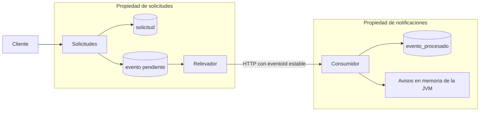
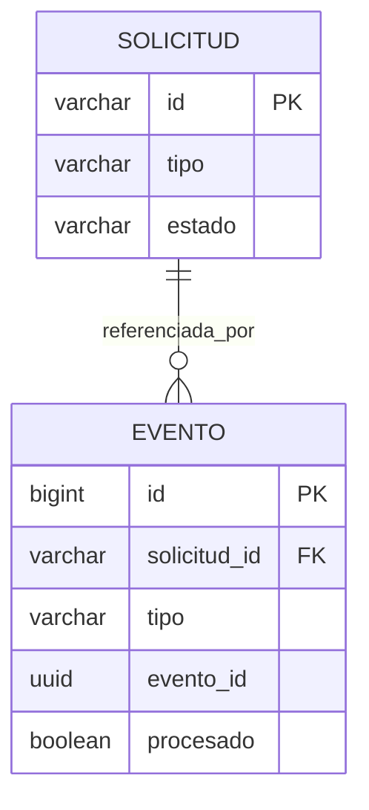
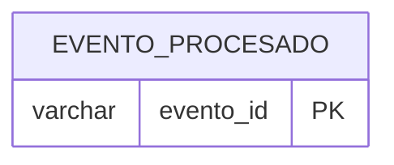
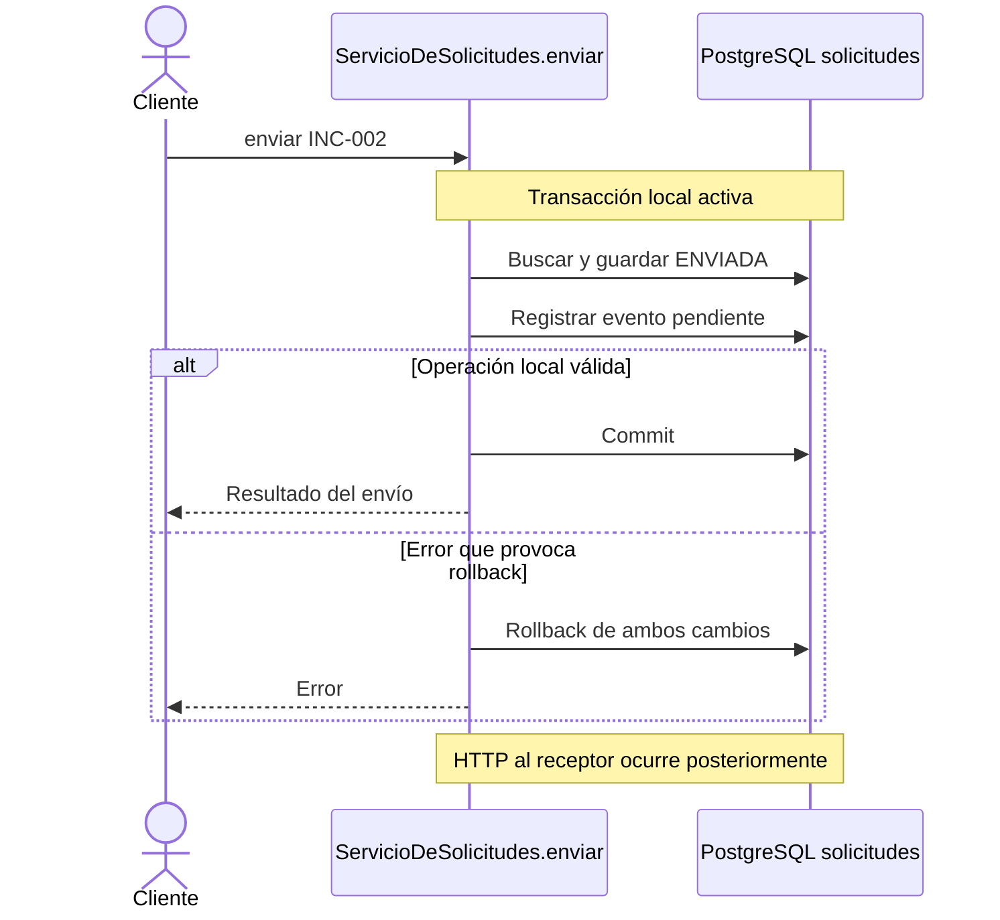
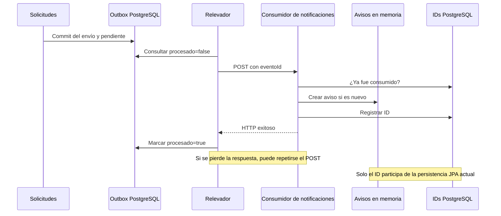
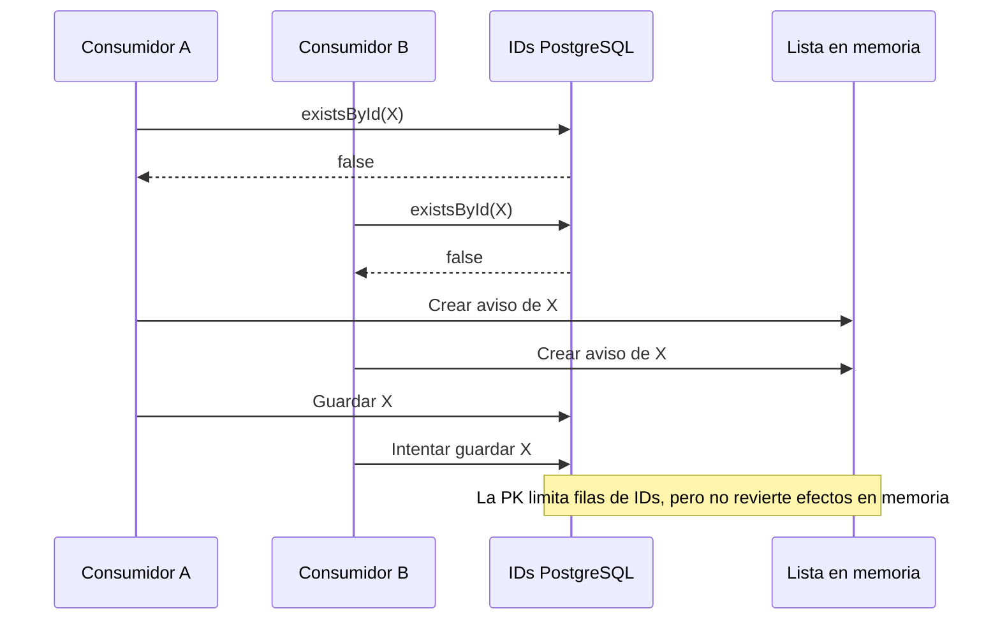
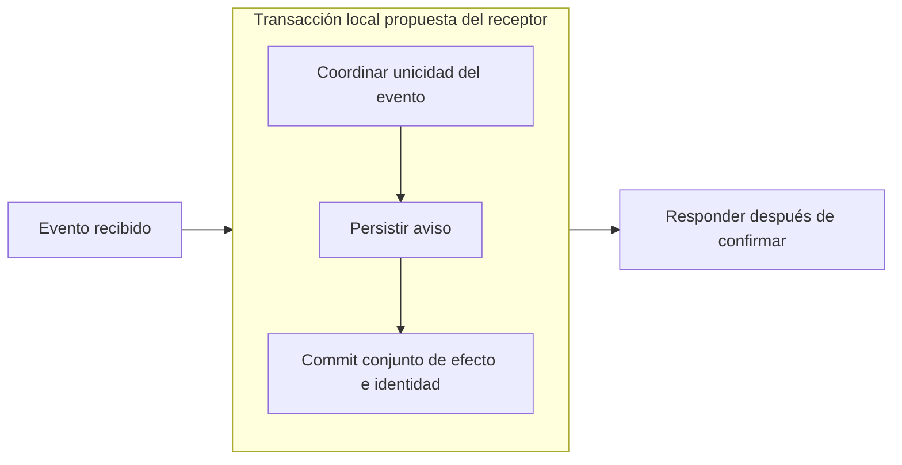
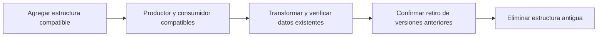

# Datos y consistencia

Material de la sección 8 para [equipo de desarrollo](equipo-desarrollo.md) y [staff](staff-desarrollo.md). Incluye conceptos, diagramas Mermaid y un guion de laboratorio. No modifica aplicaciones, esquemas ni PowerPoint.

## Objetivos y secuencia

Al terminar, la audiencia debería poder identificar la fuente de verdad de un dato, ubicar la frontera de una transacción y explicar cómo se recupera una entrega incompleta.

| Tema | Equipo | Staff |
| --- | --- | --- |
| Datos y responsables | 46 | 27 |
| Modelo, claves y restricciones | 47–48 | 27–28 |
| ACID y transacción local | 49–50 | 28 |
| Propagación y ventanas de fallo | 51–52 | 29 |
| Idempotencia y concurrencia | 53–54 | 30 |
| Evolución y recuperación | 55 | 31 |
| Laboratorio y aceptación | 56–57 | 32 |

Tiempo orientativo de esta sección: 30–40 minutos para equipo, incluyendo discusión del laboratorio, y 20–25 para staff. Son estimaciones de facilitación.

## 1. Datos, propiedad y conservación

| Dato | Dueño y ubicación actuales | Qué confirma | Límite |
| --- | --- | --- | --- |
| Estado de solicitud | Solicitudes, PostgreSQL | Situación del trámite | No prueba recepción del evento |
| Evento pendiente | Solicitudes, tabla evento | Intención durable de entrega | Requiere procesamiento posterior |
| procesado del outbox | Solicitudes, tabla evento | El publicador recibió éxito y se guardó la marca | No prueba disponibilidad permanente del aviso |
| ID consumido | Notificaciones, PostgreSQL | Registro de consumo de ese evento | No conserva el texto |
| Texto del aviso | Notificaciones, ArrayList | Aviso disponible en esa JVM | Se pierde al reiniciar y no se comparte entre Pods |

Persistir datos, mantener invariantes y propagar hechos son responsabilidades relacionadas, con garantías distintas. Ningún servicio escribe directamente la base del otro en este recorrido.



**Pregunta al público:** si la API devuelve ENVIADA y todavía no aparece el aviso, ¿cuál es el siguiente dato que consultaríamos? Primero el evento de esa solicitud y su estado de entrega, sin inferir fallo solamente por la ausencia momentánea del texto.

## 2. Modelo relacional actual



El receptor mantiene otra tabla, en su propia base:



La relación entre `evento.evento_id` y `evento_procesado.evento_id` es un contrato de aplicación por HTTP. No existe una FK entre las bases. El esquema no tiene una tabla de avisos persistentes.

- `solicitud.id`: identidad del trámite.
- `evento.id`: identidad numérica de la fila local.
- `evento.evento_id`: UUID que viaja al receptor y se reutiliza en reintentos.
- `evento.tipo`: en el flujo actual contiene `SolicitudEnviada`. Distinguirlo de `solicitud.tipo`.

La PK de `evento_procesado` protege la unicidad de ese registro. El esquema de solicitudes no declara una restricción UNIQUE sobre `evento.evento_id` ni una regla que limite a un único evento de envío por solicitud.

El CHECK de estado admite cuatro valores, pero no valida la transición entre estado anterior y nuevo. El dominio aporta esa regla. Los índices de estado y pendientes apoyan consultas, sin garantizar por sí mismos consistencia de negocio ni procesamiento único.

## 3. ACID y frontera transaccional

**Atomicidad:** el envío local debe confirmar estado y evento juntos. **Consistencia:** cada transacción debe respetar las restricciones y reglas aplicables. **Aislamiento:** define qué interacciones entre transacciones concurrentes son posibles. **Durabilidad:** un cambio confirmado debe conservarse en almacenamiento durable bajo sus condiciones de funcionamiento. La consistencia de ACID no equivale a sincronización inmediata de microservicios. [Transacciones en PostgreSQL](https://www.postgresql.org/docs/current/tutorial-transactions.html).



El método activo es `ServicioDeSolicitudes.enviar`, anotado con `@Transactional`, y utiliza los adaptadores JPA mediante puertos. `OperacionEnviar` no está conectado al recorrido real.

La anotación no convierte operaciones en memoria ni llamadas HTTP en escrituras transaccionales de PostgreSQL. La política de rollback y la participación efectiva de los adaptadores deben demostrarse con una prueba de integración. Un hueco en una secuencia BIGSERIAL tras rollback no prueba una escritura parcial: las secuencias pueden avanzar aunque la transacción aborte. [Aislamiento y particularidades de secuencias](https://www.postgresql.org/docs/current/transaction-iso.html).

## 4. Outbox Pattern: propagación y ventanas de fallo



| Ventana | Qué queda | Recuperación o límite |
| --- | --- | --- |
| Falla antes del commit local | Envío sin confirmar | Comprobar rollback |
| Commit exitoso, cliente pierde respuesta | Estado y evento pueden estar guardados | Consultar antes de repetir el comando |
| Receptor no disponible | Evento pendiente | Otro ciclo puede retomar la entrega |
| Receptor consume, respuesta HTTP se pierde | Efecto aplicado y emisor sin confirmar | Reentrega con el mismo eventoId |
| Éxito HTTP, falla marca del emisor | Evento puede seguir pendiente | Reentrega posible |
| Falla persistencia del ID tras crear aviso | Aviso puede quedar en memoria | JPA no revierte la lista Java |
| Reinicia notificaciones | ID durable y texto perdido | Repetir ID conocido no reconstruye texto |

El relevador tiene cinco segundos de espera entre ciclos y el publicador hace hasta tres intentos por publicación. No hay un plazo máximo garantizado. La recuperación depende de conservar datos, restablecer dependencias y completar el procesamiento. Un fallo permanente no se resuelve por llamarlo consistencia eventual.

## 5. Idempotencia y concurrencia

Idempotencia significa que repetir la misma operación lógica no multiplica su efecto previsto. Conservar el UUID durante una reentrega permite reconocerla. Generar otro UUID para el mismo intento de transporte evita esa identificación.



Es un escenario posible deducido del orden del código, no una prueba de concurrencia ya ejecutada. La lista ArrayList tampoco aporta coordinación entre hilos. `existsById` seguido de `save` no es una exclusión mutua.

Una segunda carrera posible aparece cuando dos peticiones leen BORRADOR antes de que alguna confirme ENVIADA. `SolicitudEntity` no tiene `@Version` y la búsqueda no declara bloqueo explícito. Ambas podrían registrar eventos con UUID distintos. La deduplicación por UUID en el receptor no identifica como duplicados esos dos hechos creados por el emisor.

**Opciones propuestas para evaluar:**

| Problema | Mecanismo posible | Condición de diseño |
| --- | --- | --- |
| Transición concurrente | UPDATE condicionado por estado y filas afectadas | Insertar evento solo si la transición ganó, en la misma transacción |
| Cambio concurrente de entidad | Bloqueo optimista con versión | Propagar correctamente versión y tratar conflictos |
| Acceso exclusivo a una fila | Bloqueo pesimista | Mantener corta la transacción y evaluar contención |
| Consumo repetido | Identidad única y efecto en una misma base | Coordinar inserción de ID y aviso en una transacción, incluyendo conflictos |
| Varios relevadores | Reclamación o bloqueo de pendientes | Diseñar recuperación de trabajo reclamado y asumir redelivery |

No basta con agregar `@Version` a una clase mientras el adaptador sigue reconstruyendo entidades sin preservar la versión. La solución requiere cambiar y verificar el recorrido completo. El aislamiento elegido tampoco elimina la necesidad de manejar conflictos y reintentos. [Aislamiento en PostgreSQL](https://www.postgresql.org/docs/current/transaction-iso.html), [restricciones](https://www.postgresql.org/docs/current/ddl-constraints.html).

### Persistencia del consumidor propuesta



Esta propuesta busca que ID y aviso permanezcan o reviertan juntos. Un conflicto concurrente debe interpretarse de acuerdo con el contrato y comprobar que no deja efectos extra. No promete entrega exactamente una vez de extremo a extremo.

## 6. Migraciones, contratos y restauración

**Situación actual:** solicitudes usa `ddl-auto=validate`, inicialización SQL y un script con CREATE y ALTER. Notificaciones configura `ddl-auto=update` y un script de esquema. No se observa Flyway ni Liquibase configurado en los archivos revisados.

El script de solicitudes contempla bases previas al outbox: al agregar `procesado` a datos históricos usa TRUE para no republicarlos automáticamente con una nueva identidad. Luego cambia el default para eventos nuevos a FALSE. No interpretar esa migración como prueba de que los eventos históricos fueron entregados.

**Propuesta:** migraciones versionadas, comprobación con datos existentes y contratos compatibles durante despliegues graduales. Ejemplo de contrato por evaluar: separar `tipoEvento` y `tipoSolicitud`, manteniendo compatibilidad mientras coexisten versiones.



Rollback de una imagen no revierte una migración ni sus efectos de negocio. Un PVC conserva almacenamiento según su ciclo de vida y política, pero no constituye por sí solo un backup independiente. Acordar RPO, pérdida de datos admisible, y RTO, tiempo de recuperación admisible. No hay objetivos numéricos comprometidos en este material. Comprobar restauración y posible reentrega de eventos tras recuperar emisor y receptor a puntos distintos.

## 7. Guion del laboratorio

Ejercicio pendiente de ejecución, limitado a un entorno de aprendizaje aislado. No elimina bases ni volúmenes. Requiere servicios y PostgreSQL preparados según [la guía local](../inicio/bases-de-datos-locales.md).

### Paso A: establecer la evidencia inicial

Usar el ID de una solicitud creada para la demostración. `INC-002` es el caso conductor; si ya fue enviado, no asumir que puede volver a BORRADOR mediante la API.

Conectar a **la base de solicitudes** y ejecutar estas consultas de solo lectura, reemplazando el ID cuando corresponda:

```sql
SELECT id, tipo, estado
FROM solicitud
WHERE id = 'INC-002';

SELECT id, solicitud_id, tipo, evento_id, procesado
FROM evento
WHERE solicitud_id = 'INC-002'
ORDER BY id;

SELECT procesado, COUNT(*) AS cantidad
FROM evento
GROUP BY procesado;
```

Anotar el UUID concreto del evento que se va a seguir. En **la base de notificaciones**, consultar ese UUID:

```sql
-- Sustituir el UUID ilustrativo por el observado en el outbox.
SELECT evento_id
FROM evento_procesado
WHERE evento_id = '29bc873c-b86d-44b5-9302-707bb7a27106';
```

Las bases son conexiones separadas. `GET /eventos/procesados` consulta IDs y `GET /notificaciones` consulta textos. Ni la tabla de IDs ni la lista de textos constituyen una consulta conjunta de entrega por solicitud.

### Paso B: simular y recuperar indisponibilidad

1. Detener solo notificaciones en el entorno aislado, con solicitudes ya iniciado.
2. Crear y enviar una solicitud de demostración según el contrato del proyecto.
3. Consultar que el estado local quedó ENVIADA y el evento sigue pendiente.
4. Restablecer el receptor y observar el mismo UUID hasta confirmar consumo y marca de entrega.
5. Registrar el intervalo observado sin convertirlo en SLA.

No se dan por ejecutados estos pasos. Si el entorno real difiere del laboratorio, adaptar primero el procedimiento de parada y acceso.

### Paso C: observar durabilidad desigual

1. Consultar textos e IDs en notificaciones después del consumo.
2. Reiniciar solo el proceso o contenedor de notificaciones conservando PostgreSQL.
3. Repetir ambas consultas: el ID permanece y el texto se pierde.
4. Explicar por qué repetir el mismo ID conocido no reconstruye el aviso.

La entrega repetida controlada y la pérdida de respuesta requieren una prueba o herramienta de inyección de fallos específica. Apagar el receptor no demuestra por sí solo el escenario de respuesta perdida después del commit.

### Paso D: definir pruebas de mejora

| Prueba propuesta | Evidencia necesaria |
| --- | --- |
| Fallo del registro del outbox | Estado y evento revertidos, leídos desde otra transacción |
| Dos envíos concurrentes | Resultado coherente con una sola transición aceptada |
| Mismo UUID secuencial y concurrente | Un efecto durable y una identidad de consumo |
| Fallo al guardar ID | Ningún aviso adicional tras recuperación |
| Reinicio del receptor mejorado | Aviso e identidad conservados |
| Restauración de backup | Datos recuperados y plan para pendientes o redelivery |

El código actual no satisface todas estas metas. El laboratorio distingue comportamiento observado, límite conocido y resultado esperado de una mejora.

## 8. Preguntas y decisiones

1. ¿Qué confirma exactamente el éxito de enviar una solicitud?
2. ¿Qué pasa si la respuesta HTTP se pierde después del consumo?
3. ¿Por qué una PK del ID no vuelve transaccional una lista Java?
4. ¿Cómo impediríamos dos transiciones basadas en el mismo BORRADOR?
5. ¿Qué debe restaurarse junto y qué eventos podrían reaparecer al restaurar?
6. ¿Quién investiga pendientes que no convergen y qué demora se comunica al usuario?

Las respuestas deben nombrar dato, frontera, condición de fallo y evidencia de recuperación.

## Fuentes

### Código y configuración verificados

- [Esquema de solicitudes y outbox](../../servicio-solicitudes/src/main/resources/schema.sql).
- [Esquema de IDs consumidos](../../servicio-notificaciones/src/main/resources/schema.notificaciones.sql).
- [Caso de uso con transacción](../../servicio-solicitudes/src/main/java/pa/gob/dntic/serviciosolicitudes/dominio/ServicioDeSolicitudes.java).
- [Entidad de solicitud sin versión](../../servicio-solicitudes/src/main/java/pa/gob/dntic/serviciosolicitudes/adaptadores/persistencia/SolicitudEntity.java).
- [Adaptador de solicitudes](../../servicio-solicitudes/src/main/java/pa/gob/dntic/serviciosolicitudes/adaptadores/persistencia/RepositorioJpa.java).
- [Relevador de pendientes](../../servicio-solicitudes/src/main/java/pa/gob/dntic/serviciosolicitudes/adaptadores/salida/RelevadorDeEventosPendientes.java).
- [Consumo y comprobación de IDs](../../servicio-notificaciones/src/main/java/pa/gob/dntic/servicionotificaciones/adaptadores/entrada/ConsumoIdempotente.java).
- [Avisos en memoria](../../servicio-notificaciones/src/main/java/pa/gob/dntic/servicionotificaciones/adaptadores/salida/RepositorioEnMemoria.java).
- [Configuración de solicitudes](../../servicio-solicitudes/src/main/resources/application.properties).
- [Configuración de notificaciones](../../servicio-notificaciones/src/main/resources/application.properties).

### Referencias conceptuales

- [PostgreSQL: transacciones](https://www.postgresql.org/docs/current/tutorial-transactions.html).
- [PostgreSQL: aislamiento](https://www.postgresql.org/docs/current/transaction-iso.html).
- [PostgreSQL: restricciones](https://www.postgresql.org/docs/current/ddl-constraints.html).

Volver al [índice de guiones](README.md).
