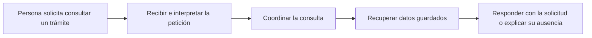
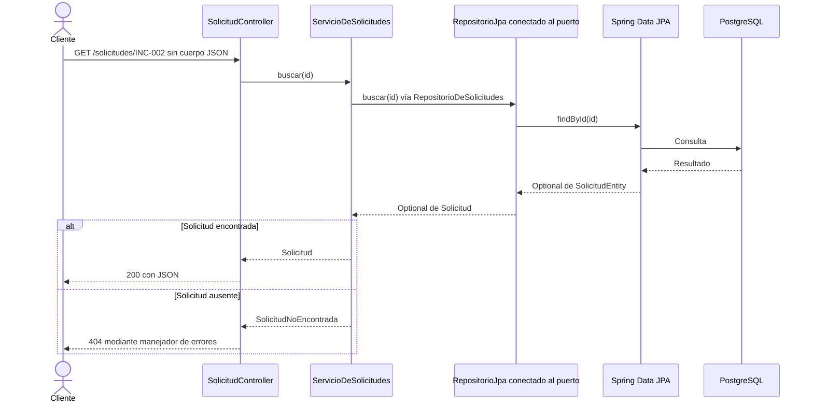
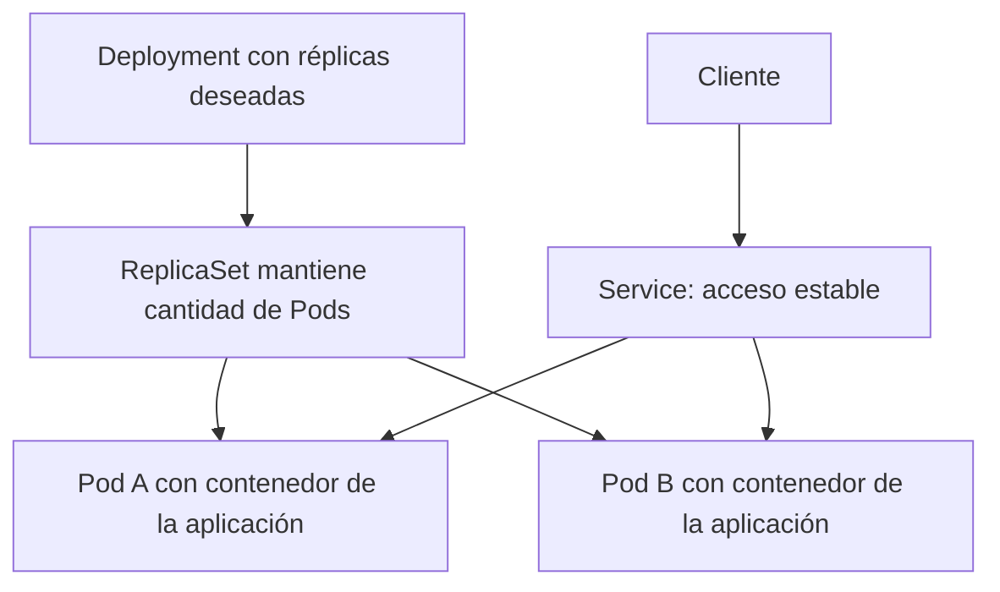
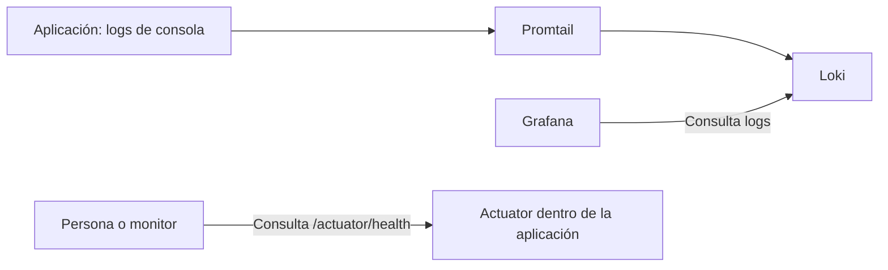

# Feedback integrado: explicación accesible y respaldo técnico

Este documento convierte las notas del equipo en explicaciones verificables. La cobertura está en los Markdown; los PowerPoint previos todavía requieren ajuste. Se conserva el temario de nueve secciones y se agrupa aquí en etapas para facilitar su comprensión.

## 1. Etapas para presentar a una audiencia mixta

| Etapa de exposición | Secciones | Pregunta que responde |
| --- | --- | --- |
| Construcción y funcionamiento | 1–3 | ¿Qué hace la aplicación y cómo se organiza su código? |
| Contenedores, operación y entrega | 4–7 | ¿Cómo la ejecutamos y cómo validamos y publicamos cambios? |
| Datos y consistencia | 8 | ¿Qué se confirma, qué puede repetirse y cómo se recupera? |
| Observabilidad | 9 | ¿Cómo sabemos qué pasó y dónde investigar? |

Cada tema se explica primero con una operación del usuario, después con un diagrama y finalmente con las clases o configuración que lo implementan. Outbox Pattern e idempotencia se desarrollan en datos y consistencia, aunque se introduzcan al recorrer el sistema.

## 2. Matriz de cobertura y correcciones

| Punto del feedback | Explicación que debe quedar | Dónde se desarrolla |
| --- | --- | --- |
| Controller, dominio, puerto, adaptador y base | El caso de uso llama por un contrato cuya implementación realiza la persistencia | Equipo 10–16, staff 05–08 y flujo-y-referencias.md |
| HTTP, JSON y 200 | HTTP lleva método, ruta, headers y un cuerpo opcional; el código de respuesta depende del resultado | Equipo 15 y guion maestro, sección 2 |
| Inicializar objeto desde repositorio | Crear y consultar son operaciones distintas; buscar recupera y transforma datos, registrar construye BORRADOR | Equipo 11–15 y ejemplo de este documento |
| Interfaz con todos los métodos de base | El puerto declara necesidades del caso de uso: guardar, buscar y todas; no un catálogo de todas las operaciones SQL | Equipo 12 |
| RepositorioQueRegistra como acceso a base | Es un adaptador en memoria con LinkedHashMap; RepositorioJpa es el activo para PostgreSQL | Equipo 12, 15–16 y flujo compartido |
| Cambiar base en un punto | El adaptador concentra acceso, pero también hay configuración, esquema, migraciones y pruebas | Equipo 16 y sección 8 |
| Compose, Kubernetes y CI/CD como lo mismo | Compose ejecuta el laboratorio; Kubernetes usa sus manifiestos; CI verifica y publica; despliegue automático ausente | Secciones 4–7 |
| Misma ejecución en cualquier entorno | La imagen reduce diferencias; siguen importando arquitectura compatible, configuración, red, recursos y datos | Sección 4 |
| Pods como repartidor de subred | Pod es unidad de ejecución; Deployment y ReplicaSet mantienen réplicas; Service dirige tráfico a destinos disponibles | Sección 5 |
| Para qué Kubernetes además de Docker | Agrega control declarativo y coordinación; un sistema puede funcionar con Docker sin Kubernetes | Sección 5 y guion maestro |
| ci.yaml comprueba ambiente | El workflow ejecuta acciones concretas: preparar, compilar, probar y publicar, según eventos y permisos | Sección 6 y ci-yaml-paso-a-paso.md |
| Base por servicio | Cada servicio tiene datos de su responsabilidad y su propia base en el laboratorio | Sección 8 |
| Logs con qué, quién, cuándo y destino | Añadir identidad de caso, resultado y contexto; diferenciar formato propuesto y mensajes existentes | Sección 9 y bloque 5 de este documento |
| Trazabilidad por header de GET | La instrumentación puede propagar contexto por headers de peticiones HTTP, también POST; hay límite en el salto asíncrono | Equipo 63 y observabilidad.md |
| Promtail como puente | Recoge fuentes configuradas, Loki guarda y Grafana consulta | Equipo 59–61 y guion-observabilidad.md |
| Actuator y health necesarios para Loki | Loki recibe logs del agente; Actuator y health corresponden a la operación de la aplicación | Equipo 62 y observabilidad.md |
| Monolito o servicios | Elegir según límites, equipos, necesidades de despliegue y complejidad operativa | Equipo 17, staff 09 y guion maestro |
| Fundamentos y aplicación de lo aprendido | Relacionar cada concepto con regla, clase, archivo, efecto y prueba | Bloque 6 de este documento |

## 3. Flujo de API con dos niveles de explicación

### Para alguien no técnico

**Texto para decir**

> Una persona pide consultar una solicitud. La entrada de la aplicación interpreta qué solicitud busca. La operación de negocio pide recuperarla y una pieza de almacenamiento se ocupa de consultar la base. Los datos regresan y la aplicación responde a la persona. Separar estos trabajos permite ubicar cambios y entender dónde ocurre un fallo.



### Para el equipo técnico

**Texto para decir**

> GET /solicitudes/INC-002 entra en SolicitudController. El controlador extrae el ID de la ruta y llama a ServicioDeSolicitudes.buscar. El caso de uso pide buscar mediante RepositorioDeSolicitudes. Spring conecta ese contrato con RepositorioJpa, que usa Spring Data JPA y convierte SolicitudEntity en Solicitud. El controlador devuelve el objeto y Spring serializa la respuesta JSON.

> Una interfaz no es un proceso intermediario que recibe y reenvía datos: define el contrato de la llamada. En ejecución se invoca la implementación conectada. RepositorioDeSolicitudes solo declara guardar, buscar y todas; no todas las capacidades de la base de datos.



### Qué significa JSON y qué cambia con POST

JSON es una representación del cuerpo cuando se usa; no sustituye método, ruta, headers o status de HTTP. En la consulta el ID viene de la ruta. `POST /solicitudes/crear` no recibe un JSON de solicitud en este controlador: construye el ejemplo INC-002 y llama a registrar. `POST /solicitudes/{id}/enviar` también toma el ID de la ruta. El POST entre servicios sí envía el evento como JSON en su cuerpo.

Los caminos exitosos del controlador actual devuelven normalmente 200. La ausencia se traduce a 404. Una transición inválida lanza IllegalStateException y no tiene un manejador específico en el código revisado. No presentar 201 o 409 como respuestas ya implementadas ni afirmar que todo POST debe responder 200.

### Repositorios y cambio de tecnología

`RepositorioQueRegistra` escribe un mensaje y conserva solicitudes en un LinkedHashMap. Sirve para demostrar otro adaptador del mismo puerto. No abre una conexión PostgreSQL. `RepositorioJpa`, marcado con @Primary, es la implementación seleccionada para persistencia de solicitudes.

Cambiar de base puede preservar el contrato, pero exige revisar adaptador, driver, URL, credenciales, SQL, tipos, restricciones, migración, transacciones y pruebas. La arquitectura reduce el alcance de los cambios del negocio; no garantiza que una sustitución completa se resuelva cambiando una clase.

## 4. Contenedores, réplicas y elección de arquitectura

### Docker y Kubernetes explicados sin confundir responsabilidades

**Texto para decir**

> Docker nos ayuda a empaquetar la aplicación con su runtime y ejecutarla como contenedor. Eso reduce diferencias entre equipos, pero seguimos necesitando configuración, conexiones y recursos adecuados. Una imagen no garantiza por sí sola que la red o la base de datos funcionen en cualquier lugar.

> Kubernetes coordina unidades de ejecución llamadas Pods. Un Pod puede contener uno o más contenedores que trabajan juntos. Cuando queremos varias réplicas de la aplicación, declaramos un Deployment que administra ReplicaSets y Pods. El Service proporciona un acceso estable y dirige tráfico hacia destinos disponibles. El Pod no es un repartidor de subredes.



Diagrama conceptual con dos réplicas, no estado real del laboratorio. Los manifiestos actuales de las aplicaciones piden una réplica. En caso de reposición debe haber capacidad, imagen, configuración y dependencias disponibles; la reposición no garantiza continuidad sin interrupción ni recupera datos en memoria. [Pods en Kubernetes](https://kubernetes.io/docs/concepts/workloads/pods/).

En ARKA-Lite, Compose levanta su conjunto local. Kubernetes se configura mediante `k8s/*.yaml`: son rutas distintas de ejecución. GitHub Actions construye y publica, sin despliegue automático. Usar Docker no obliga a usar Kubernetes.

### ¿Monolito modular o aplicaciones separadas?

| Pregunta | Monolito modular | Servicios separados |
| --- | --- | --- |
| ¿Qué se despliega? | Una aplicación organizada en módulos | Varias aplicaciones con contratos |
| ¿Cómo se comunican partes internas? | Habitualmente llamadas dentro del proceso | Puede haber llamadas de red y fallos parciales |
| ¿Qué esfuerzo operativo aparece? | Un despliegue simplifica el comienzo | Más configuración, observación y coordinación |
| ¿Cuándo considerarlo? | Límite de negocio compartido y cambio coordinado | Límites claros y necesidad de despliegue o escala independiente |
| ¿Qué exige disciplina? | Mantener módulos y dependencias entendibles | Mantener contratos, datos, recuperación y operación |

**Texto para decir**

> No elegimos arquitectura contando controladores ni anotaciones Service. Primero entendemos límites del negocio, quién cambia cada parte, cuánto necesita desplegarse por separado y qué capacidad operativa tiene el equipo. Un monolito puede estar bien modularizado. Separar procesos agrega independencia potencial, pero también red, fallos parciales y consistencia entre datos.

> ARKA-Lite usa dos servicios para aprender estas fronteras. Eso no demuestra que toda aplicación de solicitudes deba empezar con microservicios. La decisión debe justificar los beneficios frente al costo de operar y recuperar varias piezas.

## 5. Logs útiles y propagación entre servicios

### Qué debería explicar un registro

| Pregunta del feedback | Contenido útil | Ejemplo ilustrativo |
| --- | --- | --- |
| ¿Qué pasó? | Operación y resultado | publicación fallida |
| ¿Qué está involucrado? | Servicio, solicitud y evento | solicitudes, INC-002, UUID |
| ¿Cuándo? | Timestamp con zona o referencia temporal clara | instante del registro |
| ¿Para dónde va? | Destino del intento cuando aplica | servicio-notificaciones y su endpoint |
| ¿Qué ejecución lo produjo? | TraceId y spanId cuando hay contexto | contexto instrumentado |
| ¿Qué sigue? | Intento, error y acción de recuperación | reintento o pendiente conservado |

El formato propuesto es un objetivo de claridad, no una descripción de todos los campos existentes. En el código hay mensajes con IDs de solicitud y evento, pero no un esquema de campos de negocio uniformemente instrumentado. Evitar secretos y cuerpos con datos sensibles. No usar cada ID único como etiqueta de streams o de métricas.

### Cómo se propaga el contexto

**Texto para decir**

> El log no viaja como una línea pegada al GET. La instrumentación puede agregar headers de contexto a una petición HTTP saliente. La aplicación receptora los interpreta y relaciona su ejecución con el contexto recibido. Esto puede ocurrir con GET o POST. Un ejemplo de estándar es traceparent de W3C; el formato realmente emitido depende de la instrumentación y su configuración.

> En ARKA-Lite el evento se entrega mediante POST y lleva eventoId en JSON. La petición original termina antes del relevador. El outbox actual no guarda el contexto de trazas original, así que no prometemos una traza única continua. El eventoId estable permite correlacionar el mismo hecho entre intentos, aun cuando cambie la ejecución.

```mermaid
sequenceDiagram
    participant A as Servicio A instrumentado
    participant B as Servicio B instrumentado
    participant Logs as Recolección de logs
    A->>B: HTTP GET o POST con headers de contexto si se propagan
    B-->>A: Respuesta HTTP
    A->>Logs: Registro local con contexto disponible
    B->>Logs: Registro local con contexto recibido disponible
    Note over A,B: Esquema conceptual; el salto del outbox requiere diseño adicional
```

[W3C Trace Context](https://www.w3.org/TR/trace-context/) define headers de propagación HTTP. Este documento no afirma que el tráfico local se haya capturado ni que se haya verificado un header concreto del laboratorio.

### Loki, Actuator y health

Loki necesita una ruta de recepción de logs y un cliente o agente configurado para enviarlos. En este laboratorio ese agente es Promtail. Actuator es un módulo de la aplicación Spring Boot y health es uno de sus endpoints. Ninguno es requisito general para que Loki reciba logs. [Actuator y sus endpoints](https://docs.spring.io/spring-boot/reference/actuator/endpoints.html).



Dos conversaciones distintas: consultar un log almacenado y preguntar por la salud actual de una aplicación.

## 6. Cómo se aplicó lo aprendido

| Aprendizaje | Aplicación concreta | Cómo se puede demostrar |
| --- | --- | --- |
| Tipos y estados | Solicitud y Estado | Leer transición y probar entrada inválida |
| Responsabilidades | Controller, caso de uso y adaptadores | Seguir consulta y señalar cada frontera |
| Contratos e inversión de dependencias | RepositorioDeSolicitudes | Comparar JPA y adaptador en memoria |
| HTTP y serialización | Ruta de consulta y JSON de evento | Inspeccionar controlador y llamada del publicador |
| Empaquetado | Dockerfile multietapa | Identificar build y runtime |
| Operación declarativa | Deployment, Service y probes | Leer manifiestos y observar recursos reales |
| Automatización | Workflow con matriz | Abrir YAML y una ejecución real si está disponible |
| Transacciones | Envío y outbox local | Verificar rollback con PostgreSQL en prueba pendiente |
| Idempotencia | Consulta de eventoId consumido | Probar repetición y documentar límites actuales |
| Observabilidad | Logs ECS, IDs y ruta a Loki | Encontrar UUID real en ambos servicios |

Leer código demuestra estructura; pruebas y observación demuestran comportamiento. Las demostraciones propuestas aquí no se dan por ejecutadas. El aprendizaje también incluye reconocer límites: avisos en memoria, carreras posibles y despliegue no automatizado.

## 7. Verificación de comprensión al cerrar

1. Explicar en palabras cotidianas qué confirma enviar una solicitud.
2. Identificar la clase que implementa persistencia PostgreSQL y distinguirla de memoria.
3. Separar empaquetar, ejecutar, coordinar réplicas y publicar una imagen.
4. Explicar qué resuelve outbox y por qué aún puede repetirse un evento.
5. Seguir el mismo eventoId y reconocer el límite de contexto del trabajo posterior.
6. Distinguir Grafana, Loki, Promtail, Actuator y health.
7. Justificar una arquitectura por necesidades del sistema, no por popularidad.

## Referencias de código

- [Controller HTTP](../../servicio-solicitudes/src/main/java/pa/gob/dntic/serviciosolicitudes/adaptadores/entrada/SolicitudController.java).
- [Caso de uso](../../servicio-solicitudes/src/main/java/pa/gob/dntic/serviciosolicitudes/dominio/ServicioDeSolicitudes.java).
- [Puerto del repositorio](../../servicio-solicitudes/src/main/java/pa/gob/dntic/serviciosolicitudes/dominio/RepositorioDeSolicitudes.java).
- [Adaptador de memoria que registra](../../servicio-solicitudes/src/main/java/pa/gob/dntic/serviciosolicitudes/adaptadores/salida/RepositorioQueRegistra.java).
- [Adaptador JPA activo](../../servicio-solicitudes/src/main/java/pa/gob/dntic/serviciosolicitudes/adaptadores/persistencia/RepositorioJpa.java).
- [Mapeo actual de ausencia a 404](../../servicio-solicitudes/src/main/java/pa/gob/dntic/serviciosolicitudes/adaptadores/entrada/ManejadorGlobalDeErrores.java).
- [Cliente HTTP instrumentable](../../servicio-solicitudes/src/main/java/pa/gob/dntic/serviciosolicitudes/config/PropagacionDeTraza.java).
- [Workflow vigente](../../.github/workflows/ci.yml).
- [Guion maestro](guion-maestro.md).
- [Guion detallado de observabilidad](guion-observabilidad.md).
