# Guion maestro de la presentación de ARKA-Lite

Texto para ensayar las nueve secciones. Complementa el [contenido por unidad del equipo](equipo-desarrollo.md) y su [versión para staff](staff-desarrollo.md). Cada bloque **Texto para decir** es narración oral. **Apoyo** y **Demostración** son instrucciones para el expositor. No se ha regenerado PowerPoint ni ejecutado una demostración al redactarlo.

## Uso y preparación

Mantener el mismo caso durante todo el recorrido: crear una solicitud, enviarla y consultar el aviso. El endpoint de creación del laboratorio usa el ID fijo INC-002; repetir la creación puede alterar el caso existente y no genera una solicitud distinta. Preparar una base de laboratorio conocida y comprobar el estado antes del ensayo. No afirmar que la API permite crear un ID arbitrario.

Separar tres expresiones durante toda la exposición:

- **Implementado:** se reconoce en código o configuración revisada.
- **Ejemplo didáctico:** ayuda a explicar y no representa una medición observada.
- **Propuesta:** requiere implementación, configuración y validación posteriores.

Las versiones de las herramientas se toman de los archivos del proyecto, sin presentarlas como las últimas disponibles. Para demostrar GitHub, abrir una ejecución real y confirmar su SHA; si no hay acceso, explicar el YAML sin inventar resultados.

### Mapa del recorrido

```mermaid
flowchart LR
    Java[Java: datos y reglas] --> Hexagonal[Hexagonal: responsabilidades]
    Hexagonal --> Sistema[Servicios: contratos y red]
    Sistema --> Docker[Docker: empaquetado y ejecución]
    Docker --> Kube[Kubernetes: operación declarativa]
    Kube --> CI[CI/CD: validación y artefactos]
    CI --> Git[Git y GitHub: historia y revisión]
    Git --> Datos[Datos: integridad y recuperación]
    Datos --> Observacion[Observabilidad: evidencia y diagnóstico]
```

El orden conserva el temario acordado. En CI/CD se presenta brevemente qué es un commit y un PR; la sección siguiente desarrolla su mecánica. En datos se profundizan outbox e idempotencia, ya introducidos al recorrer los servicios.

### Propuesta de facilitación

| Sesión | Contenido | Propósito |
| --- | --- | --- |
| A | Secciones 1–3 | Entender código, responsabilidades y recorrido |
| B | Secciones 4–7 | Ejecutar, operar y entregar cambios |
| C | Secciones 8–9 | Entender fallos, recuperación y evidencia |

La duración depende de las preguntas y demostraciones. Los tiempos del índice son orientativos, no tiempos medidos de lectura. Ensayar y ajustar antes de fijar una agenda.

## Apertura · El caso que conecta todas las secciones

**Apoyo:** una solicitud BORRADOR, una flecha de envío y un aviso en otro servicio.

**Texto para decir**

> Vamos a seguir una solicitud durante todo su recorrido. Primero veremos cómo la representamos en Java y dónde ponemos sus reglas. Después veremos cómo dos aplicaciones colaboran, cómo las ejecutamos y cómo entregamos cambios. Finalmente revisaremos qué ocurre cuando algo falla y cómo obtenemos evidencia para entenderlo.

> La solicitud de ejemplo es INC-002. Se crea como BORRADOR y se envía. Ese envío guarda un evento que otro componente entregará al servicio de notificaciones. Desde el inicio vamos a distinguir tres hechos: el trámite quedó enviado, el evento llegó al receptor y el texto del aviso está disponible. No necesariamente ocurren al mismo instante ni se conservan de la misma forma.

> El objetivo no es memorizar nombres de herramientas. Queremos poder señalar qué componente tiene cada responsabilidad y qué dato demuestra que una operación terminó.

**Pregunta de apertura:** ¿una respuesta exitosa al enviar demuestra que el aviso ya existe?

**Respuesta esperada:** confirma el envío local; la entrega y disponibilidad del aviso deben comprobarse aparte.

## Sección 1 · Fundamentos de programación con Java

**Correspondencia:** equipo 01–09; staff 01–04.

### Código, compilación y ejecución

**Texto para decir**

> Java nos permite expresar datos y operaciones. El archivo .java contiene el código que escribimos. El JDK incluye el compilador, que revisa el programa y genera bytecode. La JVM ejecuta ese bytecode. Maven organiza dependencias, compilación, pruebas y empaquetado. Spring Boot configura componentes y el servidor de la aplicación. Cada pieza tiene una función diferente.

> En ARKA-Lite cada servicio se construye por separado y tiene su propio pom.xml. No vamos a ejecutar Maven en la raíz como si existiera un proyecto único. Cuando hacemos verify dentro de un servicio, Maven ejecuta las fases de construcción hasta esa verificación, incluidas las pruebas que correspondan a su configuración.

**Demostración:** señalar los dos pom.xml. Mostrar el comando de verificación dentro de cada servicio; ejecutarlo solo si el laboratorio está preparado.

### Tipos, nombres y objetos

**Texto para decir**

> Una variable combina un tipo con un nombre. String solicitudId indica que guardamos texto que identifica un trámite. boolean procesado expresa una condición. int intentos representa un conteo. Estado limita los estados que usamos en el programa. Estos nombres nos permiten entender el significado sin perseguir cada asignación.

> También importa dónde vive el dato. Un parámetro entra a una operación, una variable local pertenece a su bloque y un campo forma parte de un objeto. final impide reasignar la variable; no convierte automáticamente en inmutable al objeto referenciado. var permite inferir un tipo local, pero el programa sigue teniendo tipos estáticos.

> En Solicitud usamos un record. Cuando enviamos, el método produce una nueva solicitud con estado ENVIADA. La regla exige que antes esté en BORRADOR. El objeto expresa datos y una transición del negocio; no decide cómo guardar en PostgreSQL ni cómo devolver JSON por HTTP.

**Apoyo:** comparar solicitudId con dato y esperaMilisegundos con tiempo. Mostrar el método enviar del record.

### Buenas prácticas y SOLID

**Texto para decir**

> Una responsabilidad clara hace que un cambio tenga un lugar reconocible. El controlador traduce HTTP y la regla de envío pertenece al modelo. Las dependencias explícitas facilitan sustituir una implementación durante las pruebas. Cuando falla algo, necesitamos saber si corresponde rechazar, revertir o reintentar; capturar una excepción sin entender el estado resultante puede ocultar el problema.

> SOLID ofrece criterios para estas decisiones. Responsabilidad única separa motivos de cambio. Abierto y cerrado propone extender mediante puntos de variación estables. Sustitución exige conservar el comportamiento prometido. Segregación favorece contratos enfocados. Inversión de dependencias hace que la política del negocio se apoye en contratos. No significa crear una interfaz para cada clase ni que todo reemplazo sea gratuito.

**Pregunta:** si un repositorio en memoria informa ausencia para un ID desconocido, ¿puede el reemplazo inventar una solicitud?

**Respuesta esperada:** no; cambiaría el comportamiento del contrato.

**Transición oral:** “Ahora vamos a organizar esas reglas y sus dependencias dentro de una arquitectura.”

## Sección 2 · Arquitectura hexagonal

**Correspondencia:** equipo 10–16; staff 05–08.

### El core y sus fronteras

**Texto para decir**

> El core reúne las reglas del negocio y las operaciones que las coordinan. Un puerto expresa una operación que el core ofrece o necesita. Un adaptador conecta ese contrato con una tecnología concreta. La forma de un hexágono representa una frontera; no obliga a construir seis componentes.

> Sigamos una consulta. El controlador recibe el ID por HTTP y llama al caso de uso. El caso de uso pide buscar una solicitud por un contrato. El adaptador JPA realiza la consulta y transforma la entidad persistida en un objeto del dominio. Al volver, Spring serializa la respuesta. Cada frontera cambia la representación de los datos sin cambiar el significado del trámite.

> En el modelo conceptual podemos dibujar un puerto de entrada independiente. En este código el controlador llama directamente a ServicioDeSolicitudes: esa interfaz separada no existe. Sí tenemos contratos de salida como RepositorioDeSolicitudes. Siempre distinguiremos el patrón conceptual de la implementación del laboratorio.

### Petición, JSON y respuesta: explicación aplicada

**Texto para decir**

> Una petición HTTP lleva un método y una ruta, puede llevar headers y puede incluir un cuerpo. En nuestra consulta el ID está en la ruta. No necesitamos enviar JSON para buscar INC-002. Cuando la encontramos devolvemos su representación JSON. Si no existe, el manejador responde 404. Por eso no vamos a decir que toda petición GET o POST responde siempre 200.

> Crear es distinto de consultar. En este laboratorio el endpoint crear usa el ID fijo INC-002 y registrar construye BORRADOR. Consultar recupera datos existentes y el adaptador transforma la entidad de base a un objeto del dominio. ServicioDeSolicitudes coordina esas operaciones; la configuración de Spring conecta sus dependencias.

> RepositorioQueRegistra es un ejemplo en memoria con LinkedHashMap, aunque su nombre sugiera un registro. El adaptador activo que consulta PostgreSQL es RepositorioJpa. El contrato declara las necesidades del caso de uso, no todos los comandos de una base.

**Apoyo:** usar las vistas sencilla y técnica de [feedback integrado](feedback-integrado.md#3-flujo-de-api-con-dos-niveles-de-explicación).

### Dependencias y ejecución

**Texto para decir**

> Cuando hablamos de inversión de dependencias nos referimos a qué código conoce a qué código. El caso de uso conoce la interfaz que necesita; el adaptador también la conoce y la implementa. El caso de uso no necesita importar RepositorioJpa para expresar la regla.

> En ejecución, Spring conecta esa interfaz con una implementación concreta. Por eso una flecha de llamada puede ir hacia el adaptador, mientras el diagrama de dependencias muestra que ambos dependen del contrato. Son dos vistas diferentes del mismo sistema.

> La separación nos ayuda a cambiar almacenamiento y a probar reglas con menos infraestructura. Las pruebas del adaptador siguen siendo necesarias. Una carpeta llamada dominio tampoco garantiza aislamiento: en el caso de uso actual hay una anotación transaccional del framework, y otros componentes acceden directamente a JPA.

**Demostración:** abrir la interfaz del repositorio y sus implementaciones. Señalar el método buscar y la conversión a dominio.

**Pregunta:** ¿la interfaz guarda una fila por sí misma?

**Respuesta esperada:** define el contrato; el adaptador ejecuta la operación.

**Transición oral:** “La organización interna ya está clara. Ahora vamos a cruzar la frontera entre dos procesos.”

## Sección 3 · Arquitectura y comunicación entre servicios

**Correspondencia:** equipo 17–24; staff 09–14.

### Servicios y contratos

**Texto para decir**

> Una clase de servicio organiza operaciones dentro de una aplicación. Un microservicio es una aplicación ejecutable con su proceso y contrato. Aquí tenemos solicitudes y notificaciones. PostgreSQL y las herramientas de observación son infraestructura que las acompaña; no representan más reglas del trámite.

> Ambas aplicaciones se comunican por HTTP. Cada una tiene sus propios objetos Java. Lo que comparten por la red es una estructura JSON, no una instancia que vive al mismo tiempo en dos JVM. Un cambio del contrato afecta a productor y consumidor y debe planificarse.

### Cómo decidir monolito o servicios

**Texto para decir**

> Antes de separar procesos preguntamos qué partes del negocio cambian juntas, quién las mantiene y cuáles necesitan desplegarse o escalar por separado. Un monolito modular mantiene límites internos dentro de una aplicación. Separar servicios agrega fronteras de red, datos independientes y fallos parciales que debemos poder operar.

> ARKA-Lite utiliza dos servicios para aprender esas fronteras. No es una receta que obligue a todas las aplicaciones a empezar así. La decisión debe justificar los beneficios frente a la coordinación y recuperación necesarias.

**Apoyo:** tabla comparativa de [elección de arquitectura](feedback-integrado.md#4-contenedores-réplicas-y-elección-de-arquitectura).

### El envío en dos momentos

**Texto para decir**

> Cuando el usuario envía INC-002, solicitudes valida el estado y guarda dos cosas en una transacción local: la solicitud ENVIADA y un evento pendiente. Entonces puede responder. Otro componente, el relevador, consulta los pendientes y los publica por HTTP después.

> El flujo es asíncrono respecto de la petición del usuario porque la entrega ocurre fuera de ella. Cada intento HTTP del publicador sí espera una respuesta. No hay un broker Kafka o RabbitMQ en esta solución.

> El evento lleva eventoId, id de la solicitud y tipo. En el recorrido actual, tipo contiene SolicitudEnviada. Es el tipo de hecho registrado, no necesariamente el tipo original del trámite. Esa distinción será importante si evolucionamos el contrato.

### Recepción, datos y fallos

**Texto para decir**

> Notificaciones consulta si ya conoce el eventoId. Si no lo conoce, crea un aviso y guarda el identificador consumido. El texto del aviso está en memoria y el identificador está en PostgreSQL. Después de reiniciar podemos conservar el ID y perder el texto.

> El publicador hace hasta tres intentos por publicación y el relevador espera cinco segundos entre ciclos. Esa espera no es un compromiso de entrega en cinco segundos. Si falla la entrega, el pendiente puede retomarse en otro ciclo. Si se perdió la respuesta después de consumir, el evento puede llegar otra vez.

> Más adelante profundizaremos el patrón outbox y la idempotencia. Por ahora necesitamos reconocer qué momento confirma cada componente y dónde investigar lo que falta.

**Apoyo:** usar la secuencia de flujo-y-referencias.md, marcando dos bases y dos fronteras locales.

**Pregunta:** ¿el éxito del POST remoto y guardar procesado=true en el emisor son una única escritura atómica?

**Respuesta esperada:** no; existe una ventana entre ambos pasos.

**Transición oral:** “Estos componentes necesitan un entorno de ejecución. Veamos cómo los empaquetamos.”

## Sección 4 · Docker y ejecución en contenedores

**Correspondencia:** equipo 25–28; staff 15–17.

### Imagen, contenedor y Dockerfile

**Texto para decir**

> El Dockerfile es la receta. La imagen es el resultado empaquetado. El contenedor es un proceso creado desde esa imagen con una configuración de ejecución. Una misma imagen puede usarse para crear distintos contenedores.

> Empaquetar el runtime reduce diferencias. La ejecución todavía necesita arquitectura compatible, configuración, red, datos y recursos. Tener Docker o Kubernetes instalado no garantiza por sí solo que todo funcione igual.

> Nuestros Dockerfile tienen dos etapas. La etapa con Maven y JDK 26 construye el JAR. La etapa final usa JRE 26 y copia el artefacto para ejecutarlo. No necesitamos llevar Maven al proceso final. El usuario de ejecución tampoco es root.

> El build omite pruebas en package. Eso significa que construir la imagen no demuestra por sí solo que el servicio pasó sus pruebas. El workflow ejecuta verify antes de construir y publicar la imagen.

### Configuración, red y persistencia

**Texto para decir**

> DB_URL y NOTIFICACIONES_URL cambian conexiones sin editar el JAR. Dentro de Compose los servicios se encuentran por nombre. Solicitudes usa servicio-notificaciones:8080, mientras una persona en la computadora usa localhost:8081. localhost dentro de un contenedor apunta a ese contenedor, no al equipo ni a otro servicio.

> EXPOSE documenta un puerto de la imagen. El mapeo de Compose publica el acceso desde el host. Son pasos distintos. La configuración de arranque también espera dependencias saludables, pero eso no garantiza que permanezcan disponibles durante toda la ejecución.

> Los datos necesitan una vida distinta a la del proceso. El Compose actual no declara volúmenes de datos estables para las bases. Por eso no debemos prometer conservación después de recrear o limpiar esos contenedores.

**Demostración:** `docker compose config`, `docker compose ps` y `docker compose logs --tail=80 servicio-solicitudes`. Explicar cada resultado antes de avanzar. No ejecutar limpieza destructiva como parte rutinaria del ejemplo.

**Pregunta:** ¿cambiar el puerto publicado de 8081 a otro modifica el puerto interno del proceso?

**Respuesta esperada:** no necesariamente; el mapeo puede cambiar el acceso del host manteniendo el destino interno.

**Transición oral:** “Docker ejecuta los procesos. Kubernetes agrega control declarativo sobre su operación.”

## Sección 5 · Kubernetes y operación declarativa

**Correspondencia:** equipo 29–32; staff 18–19.

### Estado deseado y recursos

**Texto para decir**

> En Kubernetes declaramos qué queremos ejecutar: una imagen, un número de réplicas y una configuración. Los controladores comparan ese estado deseado con lo que ocurre y actúan para acercarlos.

> El Pod aloja los contenedores de una unidad de ejecución. El Deployment administra el despliegue y sus ReplicaSets mantienen los Pods. Un Service ofrece una dirección estable y selecciona Pods por etiquetas. Si cambia un Pod, el consumidor no debería depender de su dirección individual.

> Docker puede usarse sin Kubernetes. Kubernetes aporta coordinación declarativa cuando la necesitamos. El Pod no reparte subredes: Deployment y ReplicaSet mantienen réplicas y Service ofrece acceso estable a sus destinos disponibles.

> En el laboratorio las aplicaciones piden una réplica. Solicitudes tiene un Service NodePort y notificaciones un Service interno. Las bases usan PVC para solicitar almacenamiento y un Secret aporta la credencial. No hay Ingress, HPA ni ConfigMap declarados en estos manifiestos.

### Arranque, salud y recuperación

**Texto para decir**

> Los initContainers esperan dependencias antes de iniciar la aplicación. Readiness decide si el Pod puede recibir tráfico. Liveness, cuando se configura, permite reiniciar un contenedor que falla su comprobación. No todas estas señales están configuradas para todos los componentes.

> Las aplicaciones tienen readiness sobre /solicitudes y /notificaciones. Las bases tienen comprobaciones con pg_isready. Reponer un Pod no recupera el texto de los avisos que estaba en memoria. Un PVC tampoco sustituye un backup restaurable.

> Durante una incidencia primero preguntamos qué estado tiene el Pod, qué eventos explica Kubernetes y qué dicen los logs. Pending, ImagePullBackOff o CrashLoopBackOff llevan a investigaciones distintas. Escalar réplicas tampoco corrige automáticamente la consistencia del negocio.

**Demostración:** mostrar `kubectl get pods,svc,pvc`, `kubectl describe pod <nombre>`, logs del Deployment y estado del rollout, confirmando contexto y namespace del laboratorio.

**Pregunta:** ¿dos Pods de notificaciones comparten el mismo ArrayList de avisos?

**Respuesta esperada:** no; cada proceso tiene su memoria.

**Transición oral:** “Ahora que sabemos dónde se ejecuta una versión, veremos cómo se valida y publica.”

## Sección 6 · CI/CD con GitHub Actions

**Correspondencia:** equipo 33–41; staff 20–24.

### Integración y entrega

**Texto para decir**

> Integración continua significa comprobar cambios con construcción y pruebas de manera frecuente. La entrega continua prepara una versión validada para desplegar. El despliegue continuo automatiza además la promoción al destino cuando se cumplen sus controles.

> En ARKA-Lite el workflow verifica servicios y publica imágenes. No incluye un paso que despliegue esas imágenes a Kubernetes. Que Actions termine en verde no demuestra que el clúster esté ejecutando la versión nueva.

### Crear y leer ci.yml

**Texto para decir**

> GitHub descubre workflows en .github/workflows. El archivo puede terminar en .yml o .yaml. Aquí ya existe ci.yml: para cambiarlo lo editamos, sin crear otro archivo equivalente que duplique ejecuciones.

> name define el nombre visible. on dice qué eventos inician la ejecución. jobs agrupa trabajos y runs-on elige la máquina que los ejecuta. Dentro de steps, uses llama a una acción reutilizable y run ejecuta un comando. with configura parámetros y working-directory indica desde qué carpeta se ejecuta el paso.

> Nuestro workflow responde a pushes sobre main y a Pull Requests. Un commit es un registro de cambio y un PR es la propuesta de integrarlo; veremos cómo se crean en la siguiente sección. El archivo actual no incluye ejecución manual mediante workflow_dispatch.

### Matriz y publicación

**Texto para decir**

> La matriz declara dos pares de servicio y base. GitHub ejecuta el trabajo para cada uno, prepara PostgreSQL y Java 26, y llama a Maven dentro de la carpeta del servicio. Solicitudes tiene además una comprobación de arranque del JAR con la base.

> Después se autentica en GHCR y construye y publica la imagen con la etiqueta del SHA del commit. Ese identificador conecta código y artefacto. El token del job aporta permisos; no pegamos una contraseña personal dentro del YAML.

> La publicación también se intenta en PR y puede fallar por permisos, especialmente desde forks. Separar validación de PR y publicación en main es una mejora propuesta. La promoción entre ambientes también es una propuesta y debería conservar la misma imagen validada, con configuración por destino.

### Investigar una ejecución

**Texto para decir**

> En Actions elegimos el workflow y la ejecución del commit correcto. Abrimos el job del servicio y el paso que falló. Una falla de compilación se investiga en Maven; una publicación rechazada requiere revisar evento y permisos. Repetir la ejecución sin corregir una causa persistente no la elimina.

> Primero revisamos los dos resultados de la matriz. Después comprobamos qué imagen se publicó. Solo cuando exista un despliegue y su verificación podremos afirmar qué versión está operando.

**Demostración:** recorrer Code, archivo del workflow, Actions, run, job y logs, con el [YAML explicado](ci-yaml-paso-a-paso.md). Abrir un archivo desde GitHub es lectura; crear un commit o PR de demostración queda para el laboratorio autorizado.

**Pregunta:** ¿publicar una imagen en GHCR inicia por sí mismo un rollout de Kubernetes?

**Respuesta esperada:** no; requiere un mecanismo de despliegue adicional.

**Transición oral:** “El pipeline empieza con cambios versionados. Ahora vamos a detallar cómo se construye esa historia.”

## Sección 7 · Git y GitHub para trabajo colaborativo

**Correspondencia:** equipo 42–45; staff 25–26.

### Historia local y colaboración

**Texto para decir**

> Git guarda la historia del código y permite trabajar con ramas. Puede funcionar localmente. GitHub aloja repositorios y agrega colaboración: issues, Pull Requests, revisión y checks. Actions ejecuta automatizaciones y GHCR almacena las imágenes. Son responsabilidades relacionadas, pero diferentes.

> Una edición cambia el directorio de trabajo. git add selecciona lo que entrará al próximo commit y lo coloca en staging. git commit registra esa selección localmente. git push publica commits en el remoto. Un commit local todavía no aparece en GitHub hasta publicarse.

> Antes de registrar un cambio revisamos git status, git diff y git diff --staged. Así evitamos incluir archivos ajenos al trabajo. La rama permite proponer un cambio acotado y el PR reúne contexto, revisión y evidencia.

### Conflictos, revisión y trazabilidad

**Texto para decir**

> Un conflicto aparece cuando Git no puede combinar cambios de forma automática. Resolverlo exige entender ambas modificaciones y repetir validación; eliminar las marcas del archivo sin revisar comportamiento no basta.

> En la revisión explicamos el problema, el cambio y cómo se comprobó. Para una mejora de persistencia también explicamos datos existentes y recuperación. El pipeline aporta evidencia automatizada, pero la revisión todavía debe evaluar significado, compatibilidad y operación.

> La trazabilidad conecta issue, PR, commit, ejecución, imagen y versión desplegada. Si necesitamos deshacer un cambio compartido, revert permite registrar un cambio inverso manteniendo la historia. Proteger main y exigir checks son políticas propuestas que deben configurarse; no se presume que ya estén activas.

**Demostración:** revisar cambios en modo lectura. Mostrar una rama y un PR existentes si están disponibles, sin crear ni publicar artefactos remotos durante la explicación.

**Pregunta:** ¿un commit pequeño siempre garantiza una buena revisión?

**Respuesta esperada:** ayuda a limitar alcance, pero también hacen falta contexto, pruebas y comprensión del impacto.

**Transición oral:** “Ya sabemos cómo cambia el código. Ahora revisaremos cómo conservamos el significado de los datos cuando las operaciones fallan o se repiten.”

## Sección 8 · Datos y consistencia

**Correspondencia:** equipo 46–57; staff 27–32.

### Modelo, restricciones y ACID

**Texto para decir**

> Solicitudes es dueño del trámite y de su outbox. Notificaciones es dueño del consumo y de sus avisos. Cada base tiene sus claves y restricciones. La relación entre las bases viaja por el contrato del evento; no tenemos una FK que conecte ambas bases.

> El ID de solicitud identifica el trámite. El ID numérico del evento identifica una fila local. El UUID identifica el hecho que intentamos entregar. Confundirlos dificulta el diagnóstico y puede romper la deduplicación.

> ACID describe atomicidad, consistencia, aislamiento y durabilidad. Para el envío, la atomicidad nos interesa porque estado y evento deben confirmarse juntos. La consistencia exige mantener invariantes. El aislamiento controla interacción entre transacciones, y la durabilidad depende del almacenamiento confirmado y conservado. Ninguna de estas palabras convierte una lista Java en una escritura de PostgreSQL.

### Outbox Pattern

**Texto para decir**

> ¿Qué pasa si guardamos ENVIADA y justo después falla el HTTP? Si la intención de notificar existía solo en memoria, podríamos perderla. Outbox resuelve el registro local de esa intención: guardamos estado y evento pendiente en una misma transacción.

> El relevador toma el pendiente y lo publica después. Cuando obtiene éxito guarda la marca procesado. Si el receptor consumió pero la respuesta se perdió, el emisor puede entregar otra vez. También puede repetir si recibió éxito y no pudo guardar la marca. El patrón conserva trabajo recuperable, pero admite reentrega.

> Eventual significa que buscamos propagar el hecho posteriormente bajo condiciones de recuperación y procesamiento correcto. No garantiza convergencia frente a un fallo permanente ni fija un tiempo máximo por sí solo.

### Idempotencia y concurrencia

**Texto para decir**

> La idempotencia busca que repetir la misma operación lógica no multiplique su efecto. Para reconocer la reentrega conservamos el eventoId. Un UUID nuevo haría parecer nuevo el mismo intento de transporte.

> Nuestro consumidor consulta si conoce el ID y omite los ya registrados. Pero el texto se guarda en memoria y el ID en PostgreSQL. Si falla la persistencia del ID, la lista no se revierte automáticamente. Si el proceso reinicia, el texto se pierde y el ID permanece.

> Hay además carreras posibles: dos consumidores pueden consultar ausencia antes de escribir. Una PK evita dos filas finales con la misma clave, pero no deshace efectos previos fuera de esa base. Dos envíos también podrían leer el mismo BORRADOR y generar UUID distintos. La entidad actual no declara versión ni vemos bloqueo explícito en esa búsqueda.

> La mejora propuesta debe coordinar identidad y efecto durable, y preservar la regla de transición bajo concurrencia. Podemos evaluar actualización condicional o mecanismos de bloqueo adecuados. No declaramos exactamente una vez sin definir frontera y demostrarla.

### Migraciones, recuperación y aceptación

**Texto para decir**

> Cambiar una tabla exige pensar en datos existentes y versiones que coexistirán durante la transición. El proyecto usa scripts SQL e inicialización del esquema; no debemos presentar una plataforma de migraciones que no está configurada.

> Volver a una imagen anterior tampoco restaura automáticamente datos ni contratos. Un backup es útil cuando sabemos restaurarlo y entendemos qué pérdida y tiempo de recuperación aceptamos. Recuperar emisor y receptor a instantes distintos puede reintroducir eventos, por lo que la idempotencia vuelve a ser importante.

> La evidencia de una mejora debe cubrir rollback local, entrega recuperada, consumo repetido y concurrente, reinicio y restauración. Primero documentamos el resultado esperado y luego lo probamos. Un camino exitoso aislado no demuestra todos esos casos.

**Demostración:** seguir el [laboratorio de datos](datos-y-consistencia.md#7-guion-del-laboratorio), con consultas de solo lectura y fallos controlados en un entorno aislado. No borrar datos ni modificar el estado directamente para forzar un resultado del ejemplo.

**Pregunta:** ¿qué problema resuelve outbox y cuál exige idempotencia?

**Respuesta esperada:** outbox registra durablemente la intención junto con el cambio local; idempotencia controla efectos de repetir la misma operación o entrega.

**Transición oral:** “Para verificar todo esto necesitamos evidencia. Cerramos con observabilidad y un diagnóstico completo.”

## Sección 9 · Observabilidad

**Correspondencia:** equipo 58–65; staff 33–36.

El texto oral desarrollado, bloque por bloque, está en [Guion oral de observabilidad](guion-observabilidad.md). Forma parte de este guion maestro y contiene narración, demostración, preguntas y respuestas para las ocho unidades.

**Entrada para decir**

> La aplicación escribe, Promtail recoge, Loki guarda y Grafana muestra. Para métricas usamos otra ruta: Micrometer registra mediciones, Actuator las expone, un servidor Prometheus podría recogerlas y Grafana consultaría ese servidor. El servidor Prometheus está pendiente en nuestro Compose.

> Health es una URL de Actuator dentro de cada aplicación. Podemos consultarla sin Grafana. Informa la salud según indicadores configurados; no prueba que todos los eventos de negocio terminaron. Tampoco significa que Grafana descubra automáticamente los servicios.

**Recorrido de exposición**

1. Separar logs, métricas, trazas y datos de negocio.
2. Ubicar herramientas dentro y fuera de la aplicación.
3. Aclarar Promtail, system.log, syslog y System.err.
4. Buscar una entrega en Loki mediante Grafana Explore.
5. Consultar health y distinguirlo de métricas y chequeos del contenedor.
6. Explicar el límite de traza del trabajo posterior al request.
7. Diagnosticar enviada sin aviso con datos y logs del mismo evento.
8. Proponer indicadores y alertas con condición, responsable y acción.

**Pregunta final:** si el sistema informa UP pero un UUID no termina su recorrido, ¿qué evidencia falta?

**Respuesta esperada:** estado del evento, intentos de publicación, registro de consumo y disponibilidad del texto, además de comprobar que la telemetría llega.

## Cierre general

**Texto para decir**

> Empezamos con una regla escrita en Java y terminamos investigando una operación distribuida. La arquitectura nos permitió ubicar responsabilidades. Docker y Kubernetes nos dieron formas de ejecutar y operar. GitHub Actions y Git nos permitieron relacionar un cambio con su validación y su imagen. Datos y consistencia nos mostraron qué debe permanecer correcto cuando algo falla. Observabilidad nos dio evidencia para comprobarlo.

> Si mañana recibimos un reporte de aviso ausente, ya tenemos preguntas concretas. ¿Qué quedó confirmado? ¿Dónde se conserva? ¿Qué componente debe actuar después? ¿Puede repetirse la entrega? ¿Qué evidencia demuestra la recuperación?

> La siguiente mejora debe definir su garantía y demostrarla. Para ARKA-Lite una prioridad propuesta es conservar el aviso y su identidad de consumo de manera durable y coherente, y verificar el comportamiento concurrente. La presentación deja claros el estado actual y el trabajo necesario para llegar a esa garantía.

## Lo aprendido y cómo se aplicó

Usar la [matriz de aprendizaje aplicado](feedback-integrado.md#6-cómo-se-aplicó-lo-aprendido) para relacionar cada concepto con su clase o configuración y la evidencia necesaria. Mostrar un ejemplo real por tema antes de pasar al siguiente.

## Hoja de apoyo del expositor

| Si preguntan… | Respuesta breve |
| --- | --- |
| ¿Es Kafka? | No hay broker en este flujo; hay outbox y entrega posterior por HTTP. |
| ¿Un 200 significa que todo terminó? | Solo confirma lo definido por esa operación; hay trabajo posterior separado. |
| ¿Kubernetes conserva mi ArrayList? | No, el proceso mantiene su propia memoria. |
| ¿Outbox elimina duplicados? | Conserva intención de entrega; puede haber redelivery y se necesita tratarla. |
| ¿Idempotencia es generar UUID en cada intento? | El mismo hecho debe conservar identidad para reconocer repeticiones. |
| ¿Health pertenece a Grafana o es requisito de Loki? | Pertenece a Actuator dentro de la aplicación; Loki recibe logs por otra ruta. |
| ¿El contexto solo viaja en GET? | Puede propagarse en headers de peticiones HTTP instrumentadas, también POST. |
| ¿RepositorioQueRegistra consulta PostgreSQL? | Guarda en memoria; el adaptador de PostgreSQL es RepositorioJpa. |
| ¿Promtail recoge todos los archivos del equipo? | Solo las fuentes configuradas y accesibles; aquí usa Docker. |
| ¿Grafana guarda nuestros logs? | En este camino los logs se guardan en Loki y se consultan desde Grafana. |
| ¿Existe histórico de métricas? | No hay servidor Prometheus configurado en el Compose revisado. |
| ¿Un pipeline verde ya desplegó? | El workflow actual publica imágenes y no despliega al clúster. |

## Respaldo y fuentes

- [Fundamentos y código por unidad: equipo](equipo-desarrollo.md).
- [Adaptación para staff](staff-desarrollo.md).
- [Contratos y recorrido real, con referencias al código](flujo-y-referencias.md).
- [Docker, Kubernetes y entrega](infraestructura-y-entrega.md).
- [YAML de CI y navegación de GitHub Actions](ci-yaml-paso-a-paso.md).
- [Datos, consistencia y fuentes conceptuales](datos-y-consistencia.md#fuentes).
- [Observabilidad, configuración y referencias oficiales](observabilidad.md).
- [API y descripción del proyecto](../inicio/proyecto.md).

Las hipótesis de concurrencia se derivan del código revisado y requieren pruebas. Las demostraciones son procedimientos de ensayo pendientes de ejecución, no resultados medidos.

Cobertura del feedback recibido: [mapa de temas, correcciones y diagramas](feedback-integrado.md).
